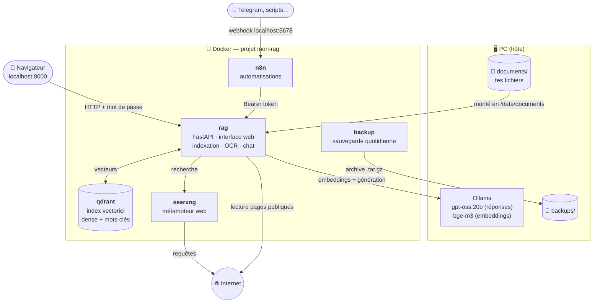

# 01 — Présentation

> [🏠 Sommaire](README.md) · [Suivant : 02 — Installation ➡](02-installation.md)

**Sur cette page**
1. [En une phrase](#1-en-une-phrase)
2. [Ce que l'assistant sait faire](#2-ce-que-lassistant-sait-faire)
3. [Les principes de conception](#3-les-principes-de-conception)
4. [Vue d'ensemble en un schéma](#4-vue-densemble-en-un-schéma)
5. [Les briques logicielles](#5-les-briques-logicielles)
6. [Ce que le projet ne fait pas](#6-ce-que-le-projet-ne-fait-pas)

---

## 1. En une phrase

Un **assistant conversationnel privé** qui répond à tes questions **à partir de tes propres documents** (CV, factures, contrats, cours, PDF scannés, photos, tableurs…), avec des **sources vérifiables**, et qui peut, si besoin, **chercher sur internet** via un métamoteur auto-hébergé — le tout **sur ton PC, sans cloud**.

C'est un système *RAG* (*Retrieval-Augmented Generation*, « génération augmentée par la recherche ») : au lieu de demander au modèle de langage de se souvenir de tout, on **cherche** d'abord les passages utiles dans tes documents, puis on lui demande de **rédiger** une réponse en s'appuyant **uniquement** sur eux.

```
   Question ──► [ Recherche dans tes documents ] ──► 6 extraits pertinents
                                                          │
                                                          ▼
   Réponse  ◄── [ Modèle de langage local : « réponds avec ces extraits seulement, cite-les » ]
```

---

## 2. Ce que l'assistant sait faire

| Capacité | Détail | Où c'est expliqué |
|---|---|---|
| 📄 **Lire presque tous tes fichiers** | PDF (même scannés), Word, OpenDocument, Excel/CSV, PowerPoint, photos (OCR), e-mails, texte, HTML… | [06 — Extraction](06-extraction.md) |
| 🔄 **Indexer tout seul** | Le dossier `documents/` est surveillé toutes les 30 s ; seuls les fichiers nouveaux/modifiés sont relus | [05 — Indexation](05-indexation.md) |
| 🔍 **Chercher intelligemment** | Par le **sens** (bge-m3) *et* par **mots-clés rares** (numéros de facture, noms propres), résultats fusionnés | [07 — Recherche hybride](07-recherche-hybride.md) |
| 🧭 **Choisir le bon outil** | Le LLM décide : tes documents, internet, ou simple conversation | [08 — Aiguillage](08-generation-reponse.md#3-laiguillage-router) |
| 💬 **Comprendre les questions de suite** | « Et là-bas ? » est réécrit en question autonome grâce à l'historique | [08 — Aiguillage](08-generation-reponse.md#3-laiguillage-router) |
| 🔗 **Citer ses sources** | Chaque information porte un renvoi `[1]` cliquable qui ouvre le document **à la bonne page** | [11 — Interface](11-interface-web.md#5-rendu-des-sources-et-des-citations) |
| 🔎 **Contrôler les chiffres** | Un montant ou une date absente des sources est signalé « À vérifier » | [08 — Vérifications](08-generation-reponse.md#7-vérifications-après-génération) |
| 🌐 **Aller sur internet si besoin** | Si tes documents ne suffisent pas → SearXNG → lecture et nettoyage des pages | [09 — Recherche web](09-recherche-web.md) |
| 🛡️ **Résister aux pièges** | Une phrase « ignore tes instructions » dans un document est retirée et signalée | [13 — Sécurité](13-securite.md) |
| 📝 **Résumer un document entier** | `/resume contrat` même pour un long document (résumé par parties) | [08 — Résumé](08-generation-reponse.md#9-la-commande-resume) |
| ⏯️ **Ne jamais perdre une réponse** | La génération continue côté serveur si l'onglet est fermé ; récupérée au retour | [11 — Reprise](11-interface-web.md#4-envoi-streaming-et-reprise-après-coupure) |
| 🤖 **S'automatiser** | API webhook (Telegram, raccourci iPhone…), synchronisation nocturne via n8n | [14 — n8n](14-n8n.md) |
| 💾 **Se sauvegarder** | Sauvegarde quotidienne automatique des conversations et de n8n | [16 — Exploitation](16-exploitation.md#3-sauvegarde-et-restauration) |

---

## 3. Les principes de conception

| Principe | Comment il se traduit dans le code |
|---|---|
| **100 % local** | LLM et embeddings via Ollama sur le PC ; index Qdrant et métamoteur SearXNG dans Docker. Seule la question reformulée part sur internet, et seulement en mode web. |
| **Fidélité avant tout** | Le prompt interdit toute connaissance extérieure ; citations obligatoires ; citations inventées retirées ; chiffres non sourcés signalés. |
| **Simple à exploiter** | Une seule commande d'installation (`make install`), secrets générés automatiquement, diagnostic `make doctor`. |
| **Sobre sur CPU** | Modèle *MoE* (`gpt-oss:20b`), une seule génération à la fois, Ollama sur l'hôte (une seule copie du modèle en RAM), cache *KV* compressé. |
| **Robuste** | Indexation incrémentale sans trou d'index, reprise des réponses, erreurs claires quand Ollama/Qdrant tombent, bascule automatique documents ⇄ internet. |
| **Originaux intouchables** | Les fichiers de `documents/` ne sont jamais modifiés ; tout est dérivé (index, état). |
| **Peu de dépendances** | Clients HTTP maison pour Ollama, Qdrant, SearXNG et n8n (pas de LangChain, pas de SDK lourds). |

---

## 4. Vue d'ensemble en un schéma



Le détail de chaque service, des ports et des volumes est dans [04 — Architecture](04-architecture.md).

---

## 5. Les briques logicielles

| Brique | Rôle | Où elle tourne | Version |
|---|---|---|---|
| [Ollama](https://ollama.com) | Sert le LLM et le modèle d'embeddings | Hôte (systemd) | — |
| `gpt-oss:20b` | LLM des réponses (MoE, 3,6 Md de paramètres actifs, ~14 Go RAM) | Ollama | modifiable |
| `bge-m3` | Embeddings multilingues (sens des textes) | Ollama | modifiable |
| Python 3.12 + FastAPI + Uvicorn | Service `rag` : API, interface, orchestration | Docker | `requirements.txt` |
| PyMuPDF, python-docx, python-pptx, openpyxl, Pillow (+HEIF) | Lecture des formats | Docker (`rag`) | |
| Tesseract (fra + eng), pandoc, catdoc | OCR et conversions | Docker (`rag`) | paquets Debian |
| trafilatura | Extraction du texte utile des pages web | Docker (`rag`) | |
| [Qdrant](https://qdrant.tech) | Base vectorielle (dense + creux, IDF) | Docker | `v1.13.4` |
| [SearXNG](https://docs.searxng.org) | Métamoteur internet sans compte | Docker | `latest` |
| [n8n](https://n8n.io) | Automatisations (facultatif) | Docker | `2.45.7` |
| SQLite | État de l'index + conversations | Fichier dans le volume `rag_state` | |
| Alpine | Boucle de sauvegarde | Docker (`backup`) | `3.20` |

---

## 6. Ce que le projet ne fait pas

- ❌ **Pas de multi-utilisateur** : un seul couple identifiant / mot de passe, une seule base de conversations.
- ❌ **Pas de HTTPS** intégré : l'accès réseau local (`BIND_ADDR=0.0.0.0`) se fait en HTTP clair → réseau de confiance uniquement.
- ❌ **Pas de GPU requis** (mais Ollama l'utilisera s'il y en a un).
- ❌ **Pas de génération parallèle** : une réponse à la fois (les autres patientent), volontairement, car un CPU ne fait pas mieux.
- ❌ **Les documents eux-mêmes ne sont pas sauvegardés** par le projet : `documents/` est à sauvegarder avec tes outils habituels.
- ❌ **L'index Qdrant n'est pas sauvegardé** : il se reconstruit à partir de `documents/`.

---

> [🏠 Sommaire](README.md) · [Suivant : 02 — Installation ➡](02-installation.md)
