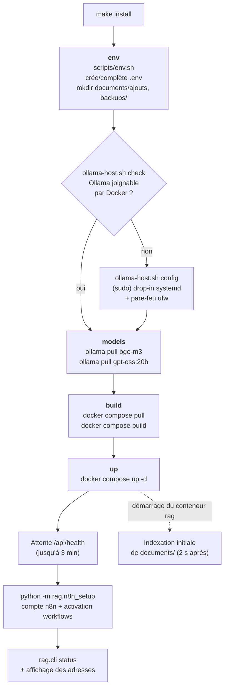

# 02 — Installation

> [⬅ Précédent : 01 — Présentation](01-presentation.md) · [🏠 Sommaire](README.md) · [Suivant : 03 — Utilisation ➡](03-utilisation.md)

**Sur cette page**
1. [Prérequis](#1-prérequis)
2. [Installation en deux commandes](#2-installation-en-deux-commandes)
3. [Ce que fait `make install`, étape par étape](#3-ce-que-fait-make-install-étape-par-étape)
4. [La configuration d'Ollama (pourquoi `sudo`)](#4-la-configuration-dollama-pourquoi-sudo)
5. [Le fichier `.env` généré](#5-le-fichier-env-généré)
6. [Vérifier que tout fonctionne](#6-vérifier-que-tout-fonctionne)
7. [Désinstaller / revenir en arrière](#7-désinstaller--revenir-en-arrière)

---

## 1. Prérequis

| Élément | Minimum | Recommandé | Vérifier avec |
|---|---|---|---|
| Système | Linux avec systemd | Ubuntu / Debian récent | `systemctl --version` |
| Docker + Compose v2 | Docker 24+ | — | `docker compose version` |
| [Ollama](https://ollama.com) | installé sur l'hôte | service systemd | `ollama --version` |
| RAM | 16 Go (avec `qwen3:8b`) | 24–32 Go (avec `gpt-oss:20b`) | `free -h` |
| Disque | ~20 Go (modèles + images) | + taille de tes documents | `df -h` |
| Outils | `make`, `bash`, `openssl` (ou `/dev/urandom`), `ss` | `ufw` (pare-feu) | |
| GPU | aucun | — | |

Installer Ollama s'il manque :
```bash
curl -fsSL https://ollama.com/install.sh | sh
```

---

## 2. Installation en deux commandes

```bash
cd mon_RAG
make stop-ancien   # uniquement si l'ancienne version (projet « rag-local ») tournait
make install       # tout le reste
```

À la fin, le terminal affiche :
```
  Chat       : http://localhost:8000   (identifiant : moi / mot de passe : Rag-xxxxxxxxxxA1)
  n8n        : http://localhost:5678   (admin@rag.local / Rag-yyyyyyyyyyA1)
  Documents  : /…/mon_RAG/documents  (indexés automatiquement en moins d'une minute)
```

💡 Les identifiants restent consultables à tout moment dans `.env` (`CHAT_USER`, `CHAT_PASSWORD`).

---

## 3. Ce que fait `make install`, étape par étape



| Étape | Fichier | Détail |
|---|---|---|
| `env` | `scripts/env.sh` | Si `.env` n'existe pas : copie `.env.example` en remplaçant `__SECRET__` (32 hex aléatoires), `__PASSWORD__` (`Rag-` + 10 hex + `A1`, accepté par n8n), `__UID__`/`__GID__` (ton utilisateur). Sinon : **ajoute seulement les clés manquantes**, sans toucher aux existantes. Droits `600`. |
| `check` / `config` | `scripts/ollama-host.sh` | Voir [§4](#4-la-configuration-dollama-pourquoi-sudo). |
| `models` | `scripts/ollama-host.sh models` | `ollama show` puis `ollama pull` si absent, pour `EMBED_MODEL` et `CHAT_MODEL`. |
| `build` | `docker-compose.yml`, `app/Dockerfile` | Télécharge Qdrant, SearXNG, n8n, Alpine ; construit l'image `mon-rag-app:local` (Python 3.12 + Tesseract + pandoc + catdoc). |
| `up` | `Makefile` | Démarre les 6 services (dont `n8n-import`, ponctuel), attend `/api/health`, configure n8n, affiche l'état. |

---

## 4. La configuration d'Ollama (pourquoi `sudo`)

Par défaut, Ollama n'écoute que sur `127.0.0.1:11434`. Or, **vu d'un conteneur, `127.0.0.1` désigne le conteneur lui-même** : le service `rag` ne peut donc pas joindre Ollama. La solution consiste à faire écouter Ollama sur toutes les interfaces, puis à joindre l'hôte via `host.docker.internal` (mappé sur la passerelle Docker par `extra_hosts: host-gateway`).

```
   Conteneur rag ──► host.docker.internal:11434 ──► passerelle Docker (172.17.0.1)
                                                        │
                                       Ollama doit écouter sur 0.0.0.0:11434
```

`make ollama-config` écrit ce fichier (une seule fois) :

```ini
# /etc/systemd/system/ollama.service.d/mon-rag.conf
[Service]
Environment="OLLAMA_HOST=0.0.0.0:11434"        # joignable par Docker
Environment="OLLAMA_FLASH_ATTENTION=1"          # attention plus économe
Environment="OLLAMA_KV_CACHE_TYPE=q8_0"         # cache KV compressé (~2× moins de RAM)
Environment="OLLAMA_NUM_PARALLEL=1"             # une requête à la fois
Environment="OLLAMA_MAX_LOADED_MODELS=2"        # LLM + embeddings en mémoire ensemble
Environment="OLLAMA_KEEP_ALIVE=30m"             # garde le modèle chargé 30 min
```

Puis `systemctl daemon-reload && systemctl restart ollama`.

🔒 **Pare-feu :** si `ufw` est actif, le script autorise le port 11434 **uniquement** depuis `172.16.0.0/12` (réseaux Docker). Sinon, il prévient qu'Ollama est joignable depuis le réseau local et propose la commande pour le restreindre.

| Cas rencontré par `check` | Message | Action |
|---|---|---|
| `ollama` absent | ✘ Ollama n'est pas installé | Installer Ollama |
| `ollama list` échoue | ✘ installé mais ne répond pas | `sudo systemctl start ollama` |
| Écoute sur `127.0.0.1` / `[::1]` | ⚠ les conteneurs ne peuvent pas le joindre | `make ollama-config` |
| Écoute sur `0.0.0.0` / `*` | ✔ joignable par Docker | — |
| Ollama hors systemd | instructions pour lancer `ollama serve` avec les bonnes variables | manuel |

---

## 5. Le fichier `.env` généré

Le `.env` contient **toute** la configuration (et les secrets). Il est ignoré par git (`.gitignore`) et lisible uniquement par toi (`chmod 600`). Contenu par catégorie :

| Catégorie | Variables principales |
|---|---|
| Accès | `CHAT_USER`, `CHAT_PASSWORD`, `RAG_API_TOKEN` |
| Réseau | `BIND_ADDR`, `RAG_PORT`, `N8N_PORT`, `N8N_PUBLIC_URL` |
| Modèles | `OLLAMA_URL`, `CHAT_MODEL`, `EMBED_MODEL`, `OLLAMA_NUM_CTX`, `LLM_THINK`… |
| Recherche | `CHUNK_SIZE`, `TOP_K`, `MIN_SCORE`, `QUERY_ROUTER`… |
| Internet | `WEB_SEARCH`, `WEB_RESULTS`, `WEB_LANG`, `SEARXNG_SECRET` |
| n8n | `N8N_OWNER_EMAIL`, `N8N_OWNER_PASSWORD`, `N8N_ENCRYPTION_KEY`, `N8N_JWT_SECRET` |
| Divers | `QDRANT_API_KEY`, `TIMEZONE`, `BACKUP_KEEP_DAYS`, `HOST_UID`… |

➡ Description exhaustive : [15 — Configuration](15-configuration.md).

---

## 6. Vérifier que tout fonctionne

```bash
make status    # résumé : Ollama, modèles, Qdrant, documents, indexation
make doctor    # diagnostic complet (charge le LLM : 1 à 2 min la 1re fois)
```

Exemple de sortie de `make doctor` :
```
✔ Ollama du PC joignable par Docker (écoute sur *:11434)
→ Tests en cours (le premier chargement du LLM peut prendre 1 à 2 min)…
✔ Ollama (modèles) (0.0 s) : http://host.docker.internal:11434 : gpt-oss:20b + bge-m3
✔ Embeddings (0.4 s) : dimension 1024
✔ Qdrant (0.0 s) : 312 morceaux indexés
✔ Recherche internet (SearXNG) (1.8 s) : 3 résultat(s)
✔ LLM (génération) (24.1 s) : « OK » en 24.1 s
✔ Mémoire : 9.8 Go libres sur 29.3 Go
```

Ensuite : `make open` ouvre le chat dans le navigateur.

---

## 7. Désinstaller / revenir en arrière

| Je veux… | Commande |
|---|---|
| Arrêter (données conservées) | `make down` |
| Tout supprimer sauf `documents/` | `make clean` ⚠️ (demande confirmation) |
| Annuler la configuration Ollama | `sudo rm /etc/systemd/system/ollama.service.d/mon-rag.conf && sudo systemctl daemon-reload && sudo systemctl restart ollama` |
| Supprimer les données de l'ancienne version | `docker volume rm $(docker volume ls -q \| grep '^rag-local_')` |
| Supprimer les modèles | `ollama rm gpt-oss:20b bge-m3` |

---

> [⬅ Précédent : 01 — Présentation](01-presentation.md) · [🏠 Sommaire](README.md) · [Suivant : 03 — Utilisation ➡](03-utilisation.md)
