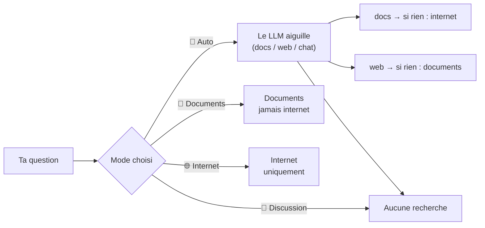

# 03 — Utilisation au quotidien

> [⬅ Précédent : 02 — Installation](02-installation.md) · [🏠 Sommaire](README.md) · [Suivant : 04 — Architecture ➡](04-architecture.md)

**Sur cette page**
1. [L'interface de chat](#1-linterface-de-chat)
2. [Les quatre modes](#2-les-quatre-modes)
3. [Les commandes du chat](#3-les-commandes-du-chat)
4. [Lire une réponse](#4-lire-une-réponse)
5. [Ajouter et gérer ses documents](#5-ajouter-et-gérer-ses-documents)
6. [Utiliser le terminal](#6-utiliser-le-terminal)
7. [Accès depuis le téléphone](#7-accès-depuis-le-téléphone)
8. [Bonnes pratiques pour de meilleures réponses](#8-bonnes-pratiques-pour-de-meilleures-réponses)

---

## 1. L'interface de chat

Ouvre **http://localhost:8000** (`make open`). Le navigateur demande l'identifiant et le mot de passe du `.env`.

```
┌────────────────────────┬───────────────────────────────────────────────────┐
│ ＋ Nouvelle conversation│ ☰   Quand se termine mon contrat ?            📁  │
│                        ├───────────────────────────────────────────────────┤
│ ▸ Quand se termine…  ✎ │                         Quand se termine mon      │
│ ▸ Résumé du CV       🗑│                         contrat ?  ◄── toi        │
│ ▸ Météo Cayenne        │                                                   │
│                        │ 📄 Mes documents                                  │
│                        │ Ton contrat se termine le **31 août 2027** [1].   │
│                        │ ┌ [1] contrat-travail.pdf  page 3 · « Durée »     │
│                        │ └ ▸ 2 autre(s) source(s) consultée(s)             │
│                        │ 18.4 s · recherche : « fin du contrat de travail »│
│                        ├───────────────────────────────────────────────────┤
│ 📁 Documents  (12)     │ [Pose ta question… (/aide pour les commandes)   ] │
│ ● gpt-oss:20b          │ [🧭 Auto ▾]  Entrée pour envoyer      [Envoyer]   │
│ ● 12 doc(s), 312 morc. │                                                   │
└────────────────────────┴───────────────────────────────────────────────────┘
   barre latérale             zone de conversation
```

| Zone | Rôle |
|---|---|
| **Barre latérale** | Conversations enregistrées, groupées (Aujourd'hui / 7 derniers jours / Ce mois-ci / Plus ancien) — clic = ouvrir, ✎ = renommer, 🗑 = supprimer, accès aux documents, état des services (rafraîchi toutes les 15 s) |
| **Zone de messages** | Questions, réponses en direct, sources, avertissements |
| **Compositeur** | `Entrée` envoie, `Maj+Entrée` va à la ligne (sur écran ≤ 820 px, `Entrée` va à la ligne) ; le bouton devient **Arrêter** pendant une réponse |
| **Sélecteur de mode** | 🧭 Auto · 📄 Mes documents · 🌐 Internet · 💬 Discussion (mémorisé dans le navigateur) |

---

## 2. Les quatre modes



| Mode | Quand l'utiliser | Bascule automatique ? |
|---|---|---|
| 🧭 **Auto** (défaut) | Presque toujours | Oui : documents → internet si rien trouvé ; internet → documents si aucun résultat |
| 📄 **Mes documents** | Informations privées, tu ne veux **rien** envoyer sur internet | Non, jamais d'internet |
| 🌐 **Internet** | Actualité, météo, prix, horaires | Non |
| 💬 **Discussion** | Rédiger, traduire, corriger, expliquer, calculer | — (aucune source) |

Exemples d'aiguillage automatique :

| Question | Outil choisi | Pourquoi |
|---|---|---|
| « Quel est mon parcours ? » | 📄 docs | « mon », concerne l'utilisateur |
| « Combien j'ai payé à EDF en mars ? » | 📄 docs | facture, montant personnel |
| « Météo à Cayenne demain ? » | 🌐 web | information qui change |
| « Traduis ce paragraphe en anglais : … » | 💬 chat | texte fourni dans le message |
| « Et à Kourou ? » (après la météo) | 🌐 web, requête « météo Kourou demain » | question de suite réécrite |

---

## 3. Les commandes du chat

| Commande | Effet | Exemple |
|---|---|---|
| `/aide` (ou `/help`, `/?`) | Affiche l'aide | `/aide` |
| `/docs` | Tableau des documents indexés + ceux qui n'ont pas pu être lus (avec l'erreur) | `/docs` |
| `/resume <nom>` | Résumé d'un document **entier**, même long. Accepte `/résumé`, `/resumer`, `/résumer`. Le nom est cherché sans accents ni casse, partiellement. | `/resume cv` |
| `/doc <question>` | Force les documents, jamais internet | `/doc numéro de sécu` |
| `/web <question>` | Directement internet | `/web prix du gazole Guyane` |
| `/chat <message>` | Sans recherche | `/chat écris un mail de relance poli` |

Une commande inconnue (`/xyz`) affiche l'aide. Une commande sans texte (`/web`) rappelle la syntaxe.

---

## 4. Lire une réponse

| Élément | Signification |
|---|---|
| Badge **📄 Mes documents** / **🌐 Trouvé sur internet** / **💬 Conversation** / **📄 Résumé** / **⌘ Commande** | D'où vient la réponse |
| « *Rien de pertinent dans tes documents → recherche sur internet* » | Bascule automatique effectuée |
| `[1]` dans le texte | Renvoi vers la source n° 1. Clic = défile jusqu'à la source et affiche l'extrait |
| Liste de sources (citées) | Nom du fichier (lien qui ouvre **à la bonne page** pour un PDF), page / diapositive / feuille, section |
| « ▸ N autre(s) source(s) consultée(s) » | Extraits fournis au modèle mais non cités |
| ⚠️ « référence(s) vers un extrait inexistant retirée(s) » | Le modèle a inventé un `[7]` alors qu'il n'y avait que 6 extraits : retiré |
| ⚠️ « Instruction suspecte ignorée dans : … » | Une tentative d'injection a été neutralisée ([13 — Sécurité](13-securite.md)) |
| 🔎 « À vérifier : 1 250, 2026… » | Ces nombres n'apparaissent dans **aucune** source : calcul du modèle ou erreur possible |
| `18.4 s · recherche : « … »` | Durée et requête réellement utilisée (après réécriture) |

Pendant la génération : un indicateur montre l'étape (« Je cherche dans tes documents… », « Je lis 4 page(s) web… »), le temps écoulé, et « (réflexion du modèle) » quand gpt-oss réfléchit.

---

## 5. Ajouter et gérer ses documents

### Trois façons d'ajouter
1. **Glisser-déposer** dans l'onglet 📁 *Documents* (ou cliquer pour choisir ; sur téléphone, prise de photo possible). Les fichiers vont dans `documents/ajouts/`.
2. **Copier** des fichiers (et sous-dossiers) dans `documents/` avec ton gestionnaire de fichiers.
3. Via un script / n8n qui écrit dans `documents/`.

Dans tous les cas, l'indexation est automatique (≤ 30 s, immédiate pour un dépôt via l'interface).

### L'onglet Documents
```
 Mes documents                     [⟳ Synchroniser] [Tout réindexer] [← Retour]
 ┌──────────────────────────────────────────────────────────────────────────┐
 │  Dépose tes fichiers ici ou clique pour choisir                          │
 └──────────────────────────────────────────────────────────────────────────┘
 ⟳ Indexation : 3/5 — ajouts/facture-mars.pdf (les photos et scans prennent environ une minute)
 ✅ ajouts/cv.pdf        6 morceaux · 2 pages · texte · 120 ko · 10/11 18:02         🗑
 ✅ contrats/bail.pdf    21 morceaux · 8 pages · texte + OCR (2 p.) · 2.3 Mo · …     🗑
 ⚪ scan-flou.jpg        aucun texte trouvé (image sans texte lisible, document vide ?) 🗑
 ⚠️ secret.pdf           PDF protégé par mot de passe                                🗑
```

| Action | Effet |
|---|---|
| ⟳ **Synchroniser** | Indexe tout de suite les fichiers nouveaux / modifiés / supprimés |
| **Tout réindexer** | Vide l'index et relit **tous** les documents (long) |
| 🗑 | Supprime le fichier du disque **et** de l'index |
| Clic sur un nom | Ouvre l'original dans un nouvel onglet |

Icônes d'état : ✅ indexé · ⚪ lu mais vide (aucun texte) · ⚠️ erreur de lecture. La liste se rafraîchit toutes les 3 s tant que l'onglet est ouvert.

| Limite | Valeur | Variable |
|---|---|---|
| Taille max d'un fichier | 200 Mo | `MAX_FILE_MB` |
| Lignes indexées par feuille de tableur | 5 000 | constante `MAX_SHEET_ROWS` |
| Noms de fichiers | nettoyés (caractères spéciaux → `_`, 150 caractères max), doublons renommés `nom (2).pdf` | — |

Fichiers **ignorés** par la surveillance : dossiers cachés (`.xxx`), `_ocr`, `__pycache__`, `node_modules`, `lost+found`, fichiers temporaires Office `~$…`, `*.part`, `*.tmp`, `*.crdownload`.

➡ Liste complète des formats : [06 — Extraction](06-extraction.md).

---

## 6. Utiliser le terminal

| Commande | Effet |
|---|---|
| `make ask Q="Quel est mon parcours ?"` | Question en mode Auto, réponse + sources citées + avertissements |
| `make web Q="Météo à Cayenne demain ?"` | Question forcée sur internet |
| `make status` | État synthétique |
| `make docs` | Liste des fichiers ✔ / ✘ avec méthode de lecture ou erreur |
| `make index` / `make reindex` | Synchroniser / tout relire (attend la fin et affiche le bilan) |

Exemple :
```
$ make ask Q="Quand ai-je obtenu mon master ?"
→ Question envoyée (gpt-oss:20b sur CPU : compte 20 s à 2 min)…

Tu as obtenu ton master informatique à l'Université de Guyane en 2018 [1].
  [1] ajouts/cv.pdf, p. 1

(docs, 21 s)
```

Les questions posées depuis le terminal **ne sont pas enregistrées** dans les conversations.

---

## 7. Accès depuis le téléphone

1. Dans `.env` : `BIND_ADDR=0.0.0.0`
2. `make up`
3. Sur le téléphone (même Wi-Fi) : `http://<IP-du-PC>:8000` (IP : `hostname -I`)

⚠️ La connexion est en **HTTP clair** : mot de passe et contenus transitent sans chiffrement. À réserver à un réseau de confiance (ou à placer derrière un VPN type WireGuard/Tailscale).

L'interface est adaptée au mobile (barre latérale repliable via ☰, dépôt de photo).

---

## 8. Bonnes pratiques pour de meilleures réponses

| Conseil | Pourquoi |
|---|---|
| Utilise les **mots exacts** du document (« avenant », « échéance ») | La recherche par mots-clés les retrouve directement |
| Pose **une question à la fois** | 6 extraits seulement sont donnés au modèle |
| Donne des **noms de fichiers parlants** (`facture-edf-2026-03.pdf`) | Le nom fait partie du texte indexé et de la liste vue par l'aiguilleur |
| Pour une vue d'ensemble, préfère `/resume` | La recherche ne remonte que des morceaux |
| Préfère des **PDF natifs** aux scans | L'OCR peut se tromper (chiffres surtout) |
| Si « rien trouvé » à tort → baisse `MIN_SCORE` ; si hors sujet → monte-le | Voir [07 — Filtre](07-recherche-hybride.md#5-filtre-de-pertinence) |

---

> [⬅ Précédent : 02 — Installation](02-installation.md) · [🏠 Sommaire](README.md) · [Suivant : 04 — Architecture ➡](04-architecture.md)
