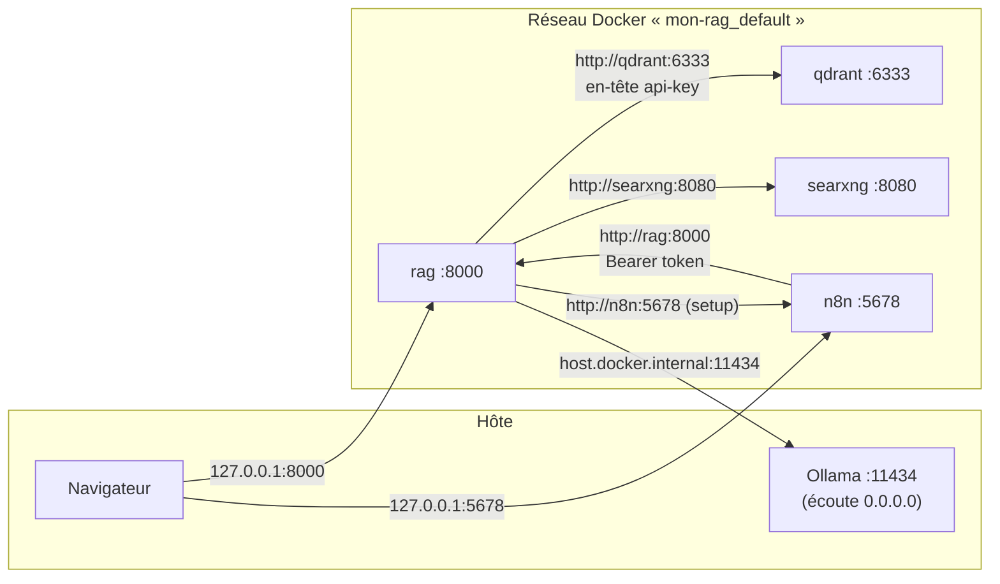
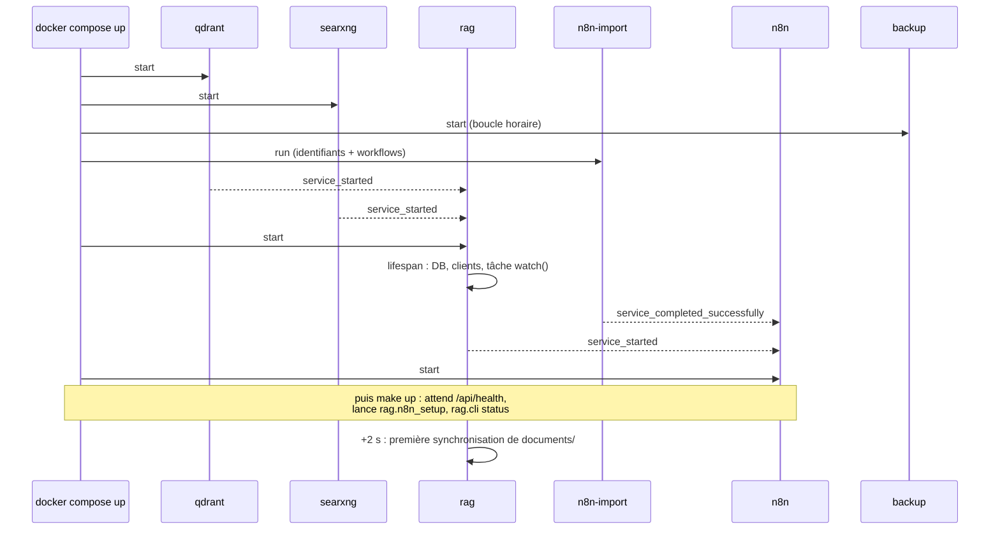
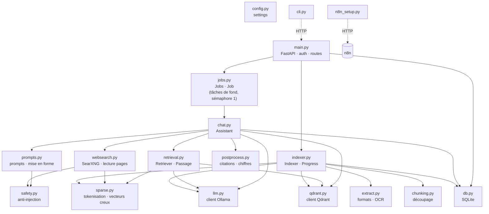

# 04 — Architecture générale

> [⬅ Précédent : 03 — Utilisation](03-utilisation.md) · [🏠 Sommaire](README.md) · [Suivant : 05 — Indexation ➡](05-indexation.md)

**Sur cette page**
1. [Vue en couches](#1-vue-en-couches)
2. [Les services Docker](#2-les-services-docker)
3. [Réseau et ports](#3-réseau-et-ports)
4. [Volumes et persistance](#4-volumes-et-persistance)
5. [Ordre de démarrage](#5-ordre-de-démarrage)
6. [Architecture interne du service `rag`](#6-architecture-interne-du-service-rag)
7. [Les deux grands flux](#7-les-deux-grands-flux)
8. [Pourquoi Ollama est sur l'hôte](#8-pourquoi-ollama-est-sur-lhôte)
9. [Arborescence du projet](#9-arborescence-du-projet)

---

## 1. Vue en couches

```
┌───────────────────────────────────────────────────────────────────────────────┐
│ PRÉSENTATION   Navigateur (index.html + app.js + style.css)   ·  make / CLI   │
│                n8n (webhook, planification)                                    │
├───────────────────────────────────────────────────────────────────────────────┤
│ API            FastAPI (main.py) : auth, routes, NDJSON streaming             │
├───────────────────────────────────────────────────────────────────────────────┤
│ ORCHESTRATION  Jobs (jobs.py)  ──►  Assistant (chat.py)                        │
│                                    aiguillage · docs · web · chat · résumé    │
├────────────────────────────┬──────────────────────────────┬───────────────────┤
│ RECHERCHE                  │ GÉNÉRATION & CONTRÔLE        │ INDEXATION        │
│ retrieval.py · sparse.py   │ prompts.py · postprocess.py  │ indexer.py        │
│ websearch.py               │ safety.py                    │ extract.py        │
│                            │                              │ chunking.py       │
├────────────────────────────┴──────────────────────────────┴───────────────────┤
│ ACCÈS AUX DONNÉES / SERVICES   llm.py (Ollama) · qdrant.py · db.py (SQLite)   │
├───────────────────────────────────────────────────────────────────────────────┤
│ INFRASTRUCTURE   Ollama (hôte) · Qdrant · SearXNG · volumes Docker · fichiers │
└───────────────────────────────────────────────────────────────────────────────┘
```

---

## 2. Les services Docker

Défini dans `docker-compose.yml` (nom de projet : **`mon-rag`**).

| Service | Image | Rôle | Redémarrage | Exposé à l'hôte |
|---|---|---|---|---|
| **`rag`** | `mon-rag-app:local` (construite depuis `app/`) | API, interface web, indexation, OCR, orchestration | `unless-stopped` | `127.0.0.1:8000` |
| **`qdrant`** | `qdrant/qdrant:v1.13.4` | Index vectoriel (dense + creux) | `unless-stopped` | ❌ non |
| **`searxng`** | `searxng/searxng:latest` | Métamoteur internet | `unless-stopped` | ❌ non |
| **`n8n-import`** | `n8nio/n8n:2.45.7` | Tâche ponctuelle : identifiants + import des workflows | `no` | ❌ |
| **`n8n`** | `n8nio/n8n:2.45.7` | Automatisations | `unless-stopped` | `127.0.0.1:5678` |
| **`backup`** | `alpine:3.20` | Boucle de sauvegarde quotidienne | `unless-stopped` | ❌ |

Paramètres communs (ancre YAML `x-base`) :
- `security_opt: no-new-privileges:true` — un processus ne peut pas gagner de privilèges.
- Logs `json-file` limités à **3 × 10 Mo** par service.

Paramètres DNS (ancre `x-dns`) : `1.1.1.1` et `9.9.9.9` par défaut (`DNS_1`, `DNS_2`), car sans eux certains conteneurs héritent de `127.0.0.53` (résolveur systemd de l'hôte, injoignable depuis Docker).

Détails notables :
| Service | Détail |
|---|---|
| `rag` | Utilisateur non-root avec **ton UID/GID** (`HOST_UID`/`HOST_GID`) → les fichiers déposés t'appartiennent. `HEALTHCHECK` sur `/api/health`. `OMP_THREAD_LIMIT=4` (Tesseract). Uvicorn **1 worker**. |
| `searxng` | `cap_drop: ALL` puis seulement `CHOWN`, `SETGID`, `SETUID`. Config montée en lecture seule. |
| `n8n` | `healthcheck` sur `/healthz`. Démarre **après** que `n8n-import` a réussi. |
| `backup` | Tourne avec ton UID, monte les volumes `rag_state` et `n8n_data` en **lecture seule**. |

---

## 3. Réseau et ports



| De → Vers | Adresse | Authentification |
|---|---|---|
| Navigateur → rag | `http://localhost:8000` | HTTP Basic (`CHAT_USER`/`CHAT_PASSWORD`) |
| Outil externe → n8n webhook | `http://localhost:5678/webhook/rag-ask` | HTTP Basic (identifiants du chat) |
| n8n → rag | `http://rag:8000` | `Authorization: Bearer RAG_API_TOKEN` |
| CLI (`make ask`…) → rag | `http://127.0.0.1:8000` (depuis le conteneur) | Bearer |
| rag → Ollama | `http://host.docker.internal:11434` | aucune (protégé par le pare-feu) |
| rag → Qdrant | `http://qdrant:6333` | en-tête `api-key: QDRANT_API_KEY` |
| rag → SearXNG | `http://searxng:8080` | aucune (réseau interne) |

`BIND_ADDR` (défaut `127.0.0.1`) contrôle l'interface sur laquelle les ports 8000 et 5678 sont publiés. ➡ [13 — Sécurité](13-securite.md).

---

## 4. Volumes et persistance

| Stockage | Type | Monté dans | Contenu | Sauvegardé ? |
|---|---|---|---|---|
| `./documents` | dossier de l'hôte | `rag:/data/documents` | **Tes originaux** | ❌ (à toi de le faire) |
| `rag_state` | volume nommé | `rag:/data/state`, `backup:/data/rag:ro` | `rag.sqlite3` (conversations, état de l'index) | ✅ quotidien |
| `qdrant_data` | volume nommé | `qdrant:/qdrant/storage` | Vecteurs et extraits | ❌ (reconstructible) |
| `n8n_data` | volume nommé | `n8n:/home/node/.n8n`, `n8n-import`, `backup:ro` | Base n8n, workflows, identifiants | ✅ quotidien |
| `./backups` | dossier de l'hôte | `backup:/backups` | Archives `auto-AAAAMMJJ.tar.gz`, `manuel-…` | — |
| `./searxng/settings.yml` | fichier | `searxng:/etc/searxng/settings.yml:ro` | Config SearXNG | (dans le projet) |
| `./n8n/workflows` | dossier | `n8n-import:/import/workflows:ro` | Workflows du projet | (dans le projet) |
| `./scripts` | dossier | `n8n-import`, `backup` (ro) | Scripts shell | (dans le projet) |

Les volumes nommés réels sont préfixés par le nom du projet : `mon-rag_rag_state`, `mon-rag_qdrant_data`, `mon-rag_n8n_data`.

➡ Détail des schémas de données : [12 — Données](12-donnees.md).

---

## 5. Ordre de démarrage



Au démarrage du service `rag` (`main.py`, fonction `lifespan`) :
1. crée `documents/` et `documents/ajouts/` si besoin ;
2. ouvre SQLite (`/data/state/rag.sqlite3`) et marque en **erreur** les réponses restées « en cours » lors d'un arrêt brutal ;
3. instancie les clients `Ollama`, `Qdrant`, puis `Indexer`, `Assistant` (avec `Retriever`), `Jobs` ;
4. lance la tâche de fond `Indexer.watch()`.

À l'arrêt : annulation de la surveillance, fermeture des clients HTTP.

---

## 6. Architecture interne du service `rag`



Tous les modules lisent leur configuration dans l'objet unique `settings` (`config.py`). ➡ Détail module par module : [19 — Référence du code](19-reference-code.md).

---

## 7. Les deux grands flux

### Flux d'écriture : indexation
```
documents/ ──scan──► fichiers nouveaux/modifiés ──extract──► pages ──chunk──► morceaux
     │                                                                          │
     └── fichiers supprimés ──► delete Qdrant + SQLite        embed (Ollama bge-m3) + sparse
                                                                                │
                                                       upsert Qdrant ──► delete anciennes versions
                                                                                │
                                                                    SQLite.files (état)
```
➡ [05 — Indexation](05-indexation.md)

### Flux de lecture : question → réponse
```
question ──► Jobs ──► Assistant.answer
                        ├─ commande ? (/aide, /docs, /resume…)
                        ├─ aiguillage LLM → route + requête autonome
                        ├─ docs : Retriever (dense ∥ sparse → RRF → filtre) → prompt → LLM stream
                        ├─ web  : SearXNG → lecture pages → prompt → LLM stream
                        └─ chat : historique → LLM stream
                     ──► post-traitement (sentinelle, citations, chiffres)
                     ──► événement « done » ──► SQLite.messages + navigateur
```
➡ [08 — Génération d'une réponse](08-generation-reponse.md)

---

## 8. Pourquoi Ollama est sur l'hôte

| Option | Avantages | Inconvénients |
|---|---|---|
| **Ollama sur l'hôte** (choix actuel) | Une seule copie du modèle en RAM, partagée avec tes autres usages d'Ollama ; accès GPU natif s'il y en a un ; mises à jour d'Ollama indépendantes | Nécessite de configurer l'écoute réseau (`make ollama-config`, sudo) |
| Ollama dans Docker | Tout est encapsulé | Duplique ~14 Go de modèle si Ollama est aussi utilisé hors du projet ; GPU plus pénible à passer |

L'ancienne version du projet (`rag-local`) utilisait un profil Docker `local-ollama` ; `make stop-ancien` l'arrête pour libérer la RAM et le port 5678.

---

## 9. Arborescence du projet

```
mon_RAG/
├── Makefile                 ← toutes les commandes (make help)
├── docker-compose.yml       ← les 6 services, volumes, réseau
├── .env.example             ← modèle de configuration (secrets à générer)
├── .env                     ← ta configuration réelle (600, ignorée par git)
├── .gitignore
├── README.md                ← aide-mémoire
├── docs/                    ← cette documentation
├── app/
│   ├── Dockerfile           ← image Python 3.12 + Tesseract + pandoc + catdoc
│   ├── requirements.txt
│   ├── rag/                 ← package Python du service
│   │   ├── main.py          API FastAPI
│   │   ├── jobs.py          tâches de réponse en arrière-plan
│   │   ├── chat.py          orchestration d'une réponse
│   │   ├── retrieval.py     recherche hybride
│   │   ├── sparse.py        vecteurs mots-clés
│   │   ├── websearch.py     internet
│   │   ├── prompts.py       prompts système
│   │   ├── postprocess.py   vérifications
│   │   ├── safety.py        anti-injection
│   │   ├── indexer.py       indexation incrémentale
│   │   ├── extract.py       lecture des formats
│   │   ├── chunking.py      découpage
│   │   ├── llm.py           client Ollama
│   │   ├── qdrant.py        client Qdrant
│   │   ├── db.py            SQLite
│   │   ├── config.py        paramètres
│   │   ├── cli.py           commandes terminal
│   │   ├── n8n_setup.py     configuration n8n
│   │   └── static/          index.html · app.js · style.css
│   └── tests/               test_unit.py · test_flow.py
├── documents/               ← TES fichiers (ajouts/ = dépôts via l'interface)
├── backups/                 ← sauvegardes (700)
├── n8n/workflows/           ← 2 workflows JSON
├── scripts/                 ← env.sh · ollama-host.sh · n8n-import.sh · backup-loop.sh · purge.sh
└── searxng/settings.yml     ← configuration du métamoteur
```

---

> [⬅ Précédent : 03 — Utilisation](03-utilisation.md) · [🏠 Sommaire](README.md) · [Suivant : 05 — Indexation ➡](05-indexation.md)
