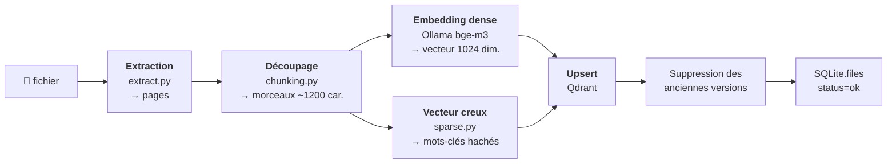
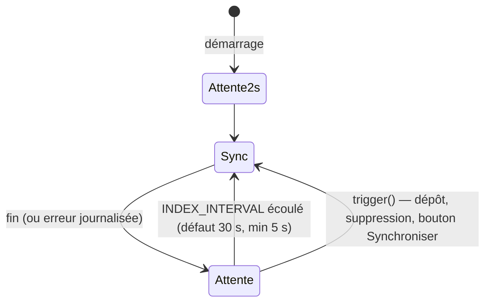
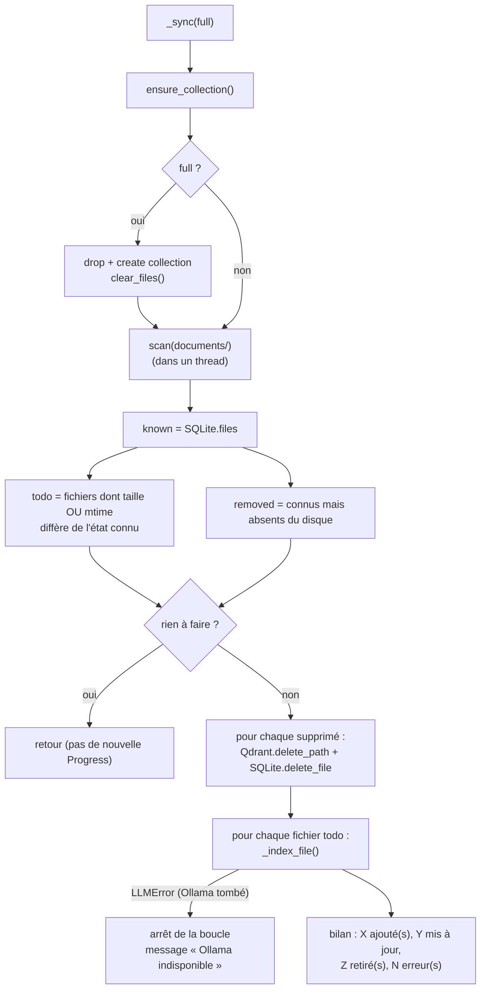
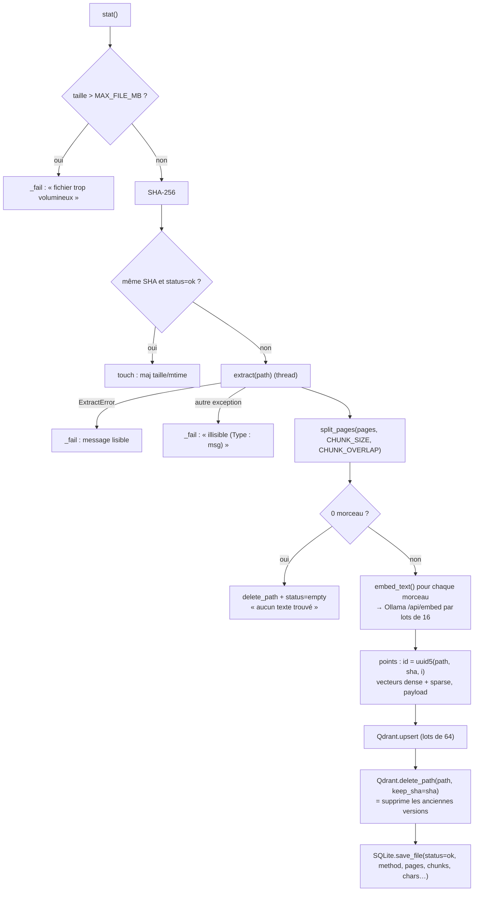
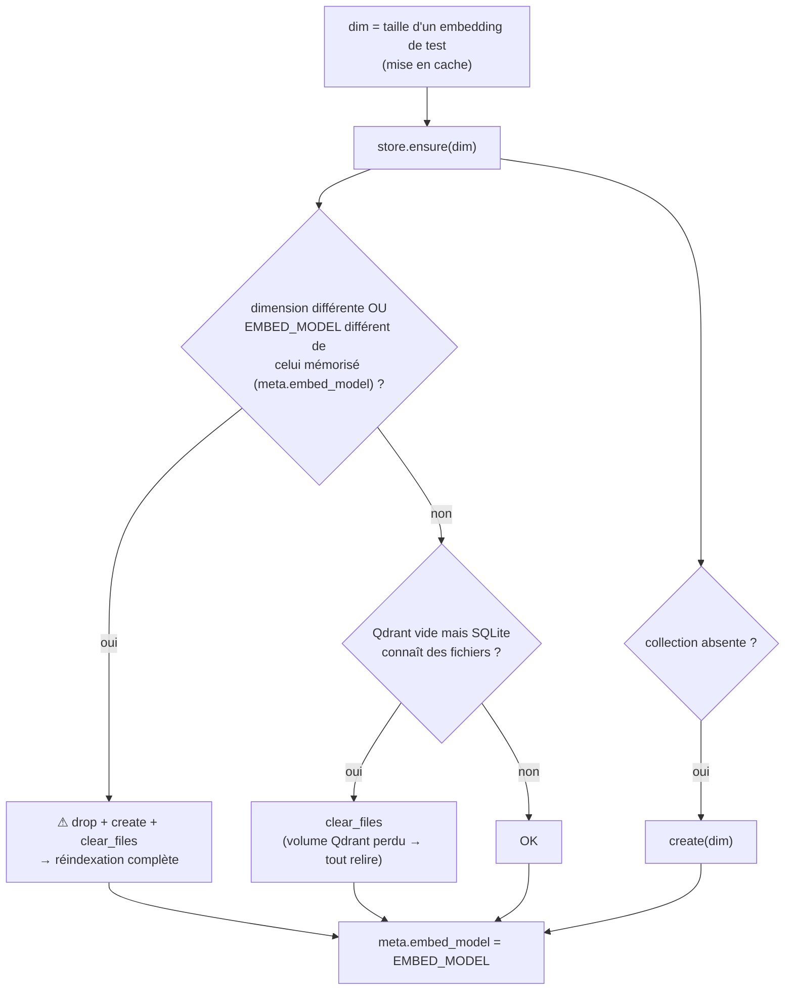

# 05 — Pipeline d'indexation

> [⬅ Précédent : 04 — Architecture](04-architecture.md) · [🏠 Sommaire](README.md) · [Suivant : 06 — Extraction ➡](06-extraction.md)

**Sur cette page**
1. [Vue d'ensemble](#1-vue-densemble)
2. [Déclenchement : la boucle de surveillance](#2-déclenchement--la-boucle-de-surveillance)
3. [Synchronisation incrémentale](#3-synchronisation-incrémentale)
4. [Indexation d'un fichier](#4-indexation-dun-fichier)
5. [Le découpage en morceaux (chunking)](#5-le-découpage-en-morceaux-chunking)
6. [Les deux vecteurs de chaque morceau](#6-les-deux-vecteurs-de-chaque-morceau)
7. [Gestion de la collection Qdrant](#7-gestion-de-la-collection-qdrant)
8. [Suivi de progression](#8-suivi-de-progression)
9. [Garanties et cas limites](#9-garanties-et-cas-limites)

Fichiers concernés : `indexer.py`, `chunking.py`, `sparse.py`, `extract.py`, `qdrant.py`, `db.py`.

---

## 1. Vue d'ensemble



---

## 2. Déclenchement : la boucle de surveillance

`Indexer.watch()` est lancée au démarrage du service et ne s'arrête jamais (toute exception est journalisée puis ignorée).



| Déclencheur | Origine | Effet |
|---|---|---|
| Minuterie | toutes les `INDEX_INTERVAL` s | `sync()` |
| `trigger()` | `POST /api/documents` (dépôt), `DELETE /api/documents`, `POST /api/index` sans option | réveille la boucle immédiatement |
| `POST /api/index {"wait": true}` | `make index`, workflow nocturne n8n | attend le verrou puis synchronise et renvoie le bilan |
| `POST /api/index {"full": true}` | bouton *Tout réindexer*, `make reindex` | vide la collection puis relit tout |

🔒 **Un seul passage à la fois** : `sync()` utilise un `asyncio.Lock`. Si une synchronisation est déjà en cours, un nouvel appel renvoie immédiatement la progression courante.

---

## 3. Synchronisation incrémentale



**Détection des changements en deux niveaux :**
1. **Rapide** : taille + date de modification (`mtime`, tolérance 1 ms) comparées à SQLite. Identiques → fichier ignoré sans même le lire.
2. **Sûre** : si l'un diffère, calcul de l'empreinte **SHA-256**. Si elle est identique à celle connue (et `status=ok`), le fichier a seulement été « touché » : on met à jour taille/mtime, sans réindexer.

**Règles du scan (`scan()`)** — sont ignorés :
- tout chemin contenant un composant commençant par `.` (fichiers/dossiers cachés, et donc les fichiers `.xxx.part` des dépôts en cours) ;
- les dossiers `_ocr`, `__pycache__`, `node_modules`, `lost+found` ;
- les fichiers `~$…` (verrous Office), `*.part`, `*.tmp`, `*.crdownload` ;
- les extensions non prises en charge.

La clé d'un fichier est son **chemin relatif POSIX** depuis `documents/` (ex. `ajouts/cv.pdf`).

---

## 4. Indexation d'un fichier

`Indexer._index_file(key, path, row)` :



### Le texte réellement vectorisé
Pour aider la recherche, chaque morceau est **contextualisé** avant l'embedding (`embed_text()`) :

```
Document : facture-edf-2026-03.pdf (page 2)        ← nom + libellé (page, feuille, diapo)
Section : Détail de la consommation                ← dernier intertitre rencontré

<texte du morceau>
```

Ainsi, une question « facture EDF de mars » trouve aussi des morceaux dont le texte seul ne mentionne ni EDF ni mars.

### Le payload stocké dans Qdrant
| Champ | Exemple | Usage |
|---|---|---|
| `path` | `ajouts/cv.pdf` | filtre (indexé `keyword`), lien vers l'original |
| `name` | `cv.pdf` | affichage, citations |
| `sha` | `9f2c…` | suppression des anciennes versions |
| `chunk` | `3` | ordre (indexé `integer`), `/resume` |
| `page` | `2` ou `null` | lien `#page=2` |
| `label` | `diapositive 4`, `feuille « Budget »` | localisation |
| `heading` | `Formation` | section affichée |
| `text` | le morceau | donné au LLM |
| `method` | `texte`, `OCR`, `texte + OCR (2 p.)`… | information |

---

## 5. Le découpage en morceaux (chunking)

Objectif : des morceaux de **~1 200 caractères** (`CHUNK_SIZE`), qui **se chevauchent** de ~200 caractères (`CHUNK_OVERLAP`), **sans couper** au milieu d'un paragraphe ou d'une phrase quand c'est évitable, et qui **retiennent la section** (intertitre) dans laquelle ils se trouvent.

### Étape 1 — Unités insécables (`_pieces`)
```
texte de la page
   │ découpage sur les lignes vides
   ▼
paragraphes ──► ≤ CHUNK_SIZE ? ──oui──► une unité
                     │non
                     ▼
         ≥ 3 retours à la ligne ? ──oui──► découpe par lignes (listes, tableaux)
                     │non
                     ▼
              découpe par phrases (après . ! ? … suivi d'une majuscule/chiffre/«)
                     │
           phrase encore trop longue ? ──► coupe au dernier espace (≥ moitié de la taille)
```

### Étape 2 — Assemblage (`split_page`)
```
unités : [## Formation] [P1 400c] [P2 500c] [P3 600c] [## Expérience] [P4 …]
                         └───── morceau 1 (≤1200) ─────┘
                                         └ chevauchement (P2 si ≤200c,
                                           sinon « …fin de P2 » coupée à un mot)
                                                       └── morceau 2 ──┘
```

Règles :
- On ajoute des unités tant que la taille reste ≤ `CHUNK_SIZE`, sinon on **émet** le morceau.
- À l'émission, on reprend les **dernières unités** totalisant ≤ `CHUNK_OVERLAP` pour démarrer le suivant. Si la dernière unité est trop longue, on reprend sa **fin** (préfixée de `…`) à partir d'un espace.
- Un **intertitre Markdown** (`# …` à `###### …`) met à jour la section courante ; s'il arrive alors que le morceau courant dépasse déjà 1/3 de la taille, il **force un nouveau morceau** (une section = un début de morceau).
- La section est **propagée d'une page à l'autre** (`split_pages`).
- Le dernier morceau n'est pas émis s'il n'est que du chevauchement déjà contenu dans le précédent.
- Les pages vides sont ignorées.

D'où viennent les intertitres ? Des extracteurs : styles *Titre 1/Heading 1* (Word), titres pandoc, détection heuristique dans les PDF (ligne courte isolée commençant par une majuscule), noms de feuilles de tableur. ➡ [06 — Extraction](06-extraction.md).

---

## 6. Les deux vecteurs de chaque morceau

| | Vecteur **dense** (`dense`) | Vecteur **creux** (`sparse`) |
|---|---|---|
| Calculé par | Ollama, modèle `bge-m3` | `sparse.doc_vector()` en Python pur |
| Sur quel texte | `embed_text()` (contexte + morceau) | `nom + section + morceau` |
| Dimension | 1024 (bge-m3) | ~2³¹ (indices = hachage CRC32 des mots) |
| Capture | le **sens** (synonymes, paraphrases, autres langues) | les **mots exacts rares** (n° de facture, noms propres, références) |
| Distance | cosinus | produit scalaire pondéré par l'**IDF** calculée par Qdrant (`modifier: idf`) |

### Construction du vecteur creux (`sparse.py`)
```
"Factures EDF n° FA-2026-0042"
   │ minuscules + suppression des accents (NFKD)
   ▼
"factures edf n fa-2026-0042"
   │ tokens [a-z0-9]+ (nombres décimaux gardés : 12,50 / 1.200)
   ▼
[factures, edf, n, fa, 2026, 0042]
   │ − mots vides FR/EN (le, de, the, of…)  − lettres seules (sauf chiffres)
   │ − pluriel simple : >4 lettres finissant par s/x → sans (factures → facture)
   ▼
[facture, edf, fa, 2026, 0042]
   │ indice = crc32(token) & 0x7FFFFFFF ; poids = 1 + ln(nb d'occurrences)
   ▼
{indices: [...triés...], values: [1.0, 1.0, ...]}
```
Pour une **requête**, chaque token distinct a le poids 1.0 (`query_vector`). Qdrant multiplie par l'IDF (rareté du mot dans tout le corpus) : un numéro de facture unique pèse beaucoup, « contrat » présent partout pèse peu.

---

## 7. Gestion de la collection Qdrant

`Indexer.ensure_collection()` est appelé au début de **chaque** synchronisation :



Création de la collection :
```json
PUT /collections/documents
{
  "vectors":        { "dense":  { "size": 1024, "distance": "Cosine" } },
  "sparse_vectors": { "sparse": { "modifier": "idf" } },
  "on_disk_payload": true
}
```
+ index de payload : `path` (keyword), `chunk` (integer).

---

## 8. Suivi de progression

L'objet `Progress` (exposé par `/api/status` et `/api/documents` sous la clé `indexing`) :

| Champ | Sens |
|---|---|
| `running` | synchronisation en cours |
| `started_at`, `finished_at` | horodatages Unix |
| `total`, `done` | fichiers à traiter / traités |
| `current` | fichier en cours |
| `added`, `updated`, `removed` | compteurs |
| `errors` | liste « `chemin : message` » |
| `message` | bilan lisible (« 3 ajouté(s), 1 mis à jour, 0 retiré(s), 1 erreur(s) ») |

Un nouvel objet `Progress` n'est créé que s'il y a **effectivement** quelque chose à faire : le dernier bilan reste donc consultable entre deux passages.

---

## 9. Garanties et cas limites

| Garantie / cas | Comportement |
|---|---|
| **Pas de trou d'index** pendant une mise à jour | Les nouveaux points (ID dépendant du SHA) sont écrits **avant** la suppression des anciens (`delete_path(keep_sha=…)`) |
| **Idempotence** | ID de point = `uuid5(NS, path ␀ sha ␀ i)` : réindexer le même contenu réécrit les mêmes points |
| Fichier illisible / protégé | `status=error` + message, anciens morceaux supprimés, la synchro continue avec les autres |
| Fichier sans texte (photo de paysage) | `status=empty` |
| **Ollama tombe** en cours de route | La boucle s'arrête (inutile d'insister), message « Ollama indisponible », reprise au passage suivant |
| Fichier renommé | Vu comme supprimé + ajouté (réindexé) |
| Changement de `EMBED_MODEL` | Réindexation complète automatique |
| Changement de `CHUNK_SIZE`/`CHUNK_OVERLAP` | **Pas** automatique → `make reindex` |
| Volume Qdrant supprimé | Détecté (Qdrant vide, SQLite non vide) → réindexation complète |
| Extraction lourde (OCR) | Exécutée dans un thread (`asyncio.to_thread`) : l'API reste réactive |

---

> [⬅ Précédent : 04 — Architecture](04-architecture.md) · [🏠 Sommaire](README.md) · [Suivant : 06 — Extraction ➡](06-extraction.md)
