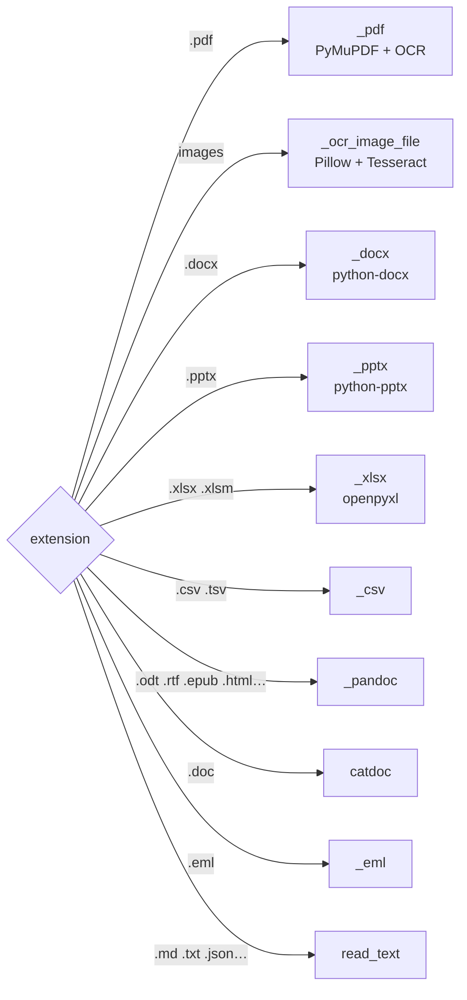
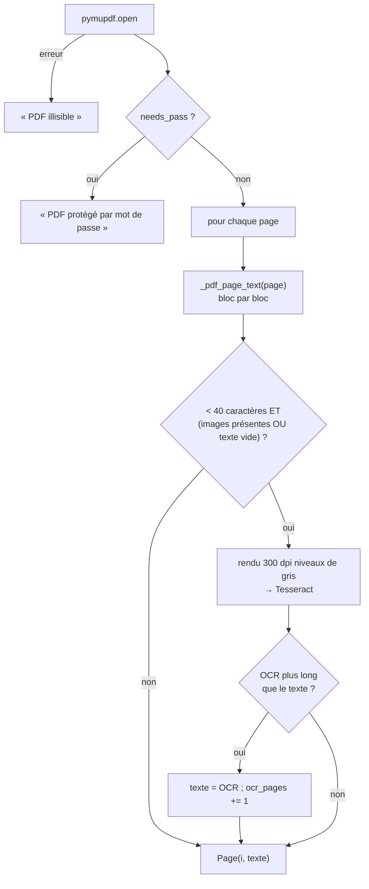

# 06 — Extraction des formats

> [⬅ Précédent : 05 — Indexation](05-indexation.md) · [🏠 Sommaire](README.md) · [Suivant : 07 — Recherche hybride ➡](07-recherche-hybride.md)

**Sur cette page**
1. [Principe : tout devient une liste de pages](#1-principe--tout-devient-une-liste-de-pages)
2. [Tableau des formats](#2-tableau-des-formats)
3. [PDF (texte et scans)](#3-pdf-texte-et-scans)
4. [Images et OCR](#4-images-et-ocr)
5. [Word (.docx) et .doc](#5-word-docx-et-doc)
6. [Tableurs (.xlsx, .csv, .tsv)](#6-tableurs-xlsx-csv-tsv)
7. [Présentations (.pptx)](#7-présentations-pptx)
8. [Formats convertis par pandoc](#8-formats-convertis-par-pandoc)
9. [E-mails (.eml) et texte brut](#9-e-mails-eml-et-texte-brut)
10. [Nettoyage commun](#10-nettoyage-commun)
11. [Erreurs possibles](#11-erreurs-possibles)

Fichier concerné : `app/rag/extract.py`. Outils système installés dans l'image : `tesseract-ocr` (+ `fra`, `eng`), `pandoc`, `catdoc`.

---

## 1. Principe : tout devient une liste de pages

```python
@dataclass
class Page:
    number: int | None   # n° de page PDF / diapositive / feuille  → lien « #page=N »
    text: str            # texte (Markdown léger : ## titres, tableaux | … |)
    label: str = ""      # « diapositive 3 », « feuille « Budget » », « tableau »

@dataclass
class Extracted:
    pages: list[Page]
    method: str          # « texte », « OCR », « texte + OCR (2 p.) », « tableau »…
```

`extract(path)` aiguille selon l'extension (en minuscules) :



---

## 2. Tableau des formats

| Famille | Extensions | Outil | Pages produites | `method` |
|---|---|---|---|---|
| PDF | `.pdf` | PyMuPDF (+ Tesseract) | 1 par page, numérotée | `texte` / `OCR` / `texte + OCR (N p.)` |
| Images | `.jpg .jpeg .png .webp .tif .tiff .bmp .gif .heic .heif` | Pillow (+ pillow-heif) + Tesseract | 1, sans numéro | `OCR` |
| Word | `.docx` | python-docx | 1 | `texte` |
| Word ancien | `.doc` | catdoc | 1 | `conversion` |
| Présentations | `.pptx` | python-pptx | 1 par diapositive, label `diapositive N` | `présentation` |
| Classeurs | `.xlsx .xlsm` | openpyxl | 1 par feuille | `tableau` |
| Tableaux texte | `.csv .tsv` | module `csv` | 1, label `tableau` | `tableau` |
| Documents convertis | `.odt .rtf .epub .html .htm .org .rst .tex` | pandoc → Markdown GFM | 1 | `conversion` |
| E-mails | `.eml` | module `email` | 1 | `e-mail` |
| Texte | `.md .markdown .txt .text .log .json .yaml .yml .xml .ini .cfg` | lecture directe | 1 | `texte` |

---

## 3. PDF (texte et scans)



**Lecture bloc par bloc** (`_pdf_page_text`) : PyMuPDF fournit les blocs de texte dans l'ordre du document, ce qui **respecte les colonnes** (un CV à deux colonnes n'est pas mélangé ligne à ligne).

Dans chaque bloc :
- les blocs **image** sont ignorés ;
- les retours à la ligne de mise en page sont **recollés** en espaces (sinon un texte justifié sort « un mot par ligne »), **sauf** devant une puce (`•`, `-`, `1.`, `a)`…) ;
- les césures `exem- ple` sont recollées ;
- **détection d'intertitre** : un bloc d'**une seule ligne**, de 3 à 40 caractères, commençant par une majuscule, sans ponctuation ni chiffre ni `@`/`/`, d'au plus 4 mots (ex. « Formation », « Expérience professionnelle ») devient `## Formation` → il servira de **section** aux morceaux.

Méthode finale : `texte` (0 page OCR), `OCR` (toutes), `texte + OCR (N p.)` (mixte).

---

## 4. Images et OCR

```
image ──► exif_transpose (rotation du téléphone)
      ──► niveaux de gris
      ──► agrandissement ×(1800 / plus grand côté), max ×3, si < 1800 px
      ──► autocontraste
      ──► PNG ──► tesseract stdin stdout -l fra+eng --psm 3   (délai max 240 s)
      ──► clean()
```

- Les **HEIC/HEIF** (photos iPhone) sont ouverts grâce à `pillow-heif`.
- Seule la **première image** d'un fichier multi-images (GIF, TIFF) est lue (`seek(0)`).
- Langues : `OCR_LANGS` (défaut `fra+eng` ; seules ces deux langues sont installées dans l'image).
- `--psm 3` : segmentation automatique de la page.
- `OMP_THREAD_LIMIT=4` (Dockerfile) limite les threads de Tesseract.

---

## 5. Word (.docx) et .doc

**.docx** — parcours du corps du document **dans l'ordre** (paragraphes et tableaux entrelacés) :
| Élément | Transformation |
|---|---|
| Style `Heading N` / `Titre N` | `#…# texte` (N dièses, max 6) |
| Style `Title` / `Titre` | `# texte` |
| Paragraphe normal | texte |
| Tableau | tableau Markdown ; les cellules fusionnées répétées sont dédupliquées |

**.doc** (ancien format binaire) — `catdoc -w -d utf-8`.

---

## 6. Tableurs (.xlsx, .csv, .tsv)

Un tableur indexé « tel quel » se retrouve très mal (des chiffres sans contexte). Chaque **ligne** devient donc une **fiche** autonome « colonne : valeur » :

```
Feuille « Dépenses »                        ## Feuille « Dépenses »
┌──────────┬──────────┬────────┐            Colonnes : Date | Fournisseur | Montant
│ Date     │Fournisseur│Montant │    ──►     Ligne 2 — Date : 2026-03-04 ; Fournisseur : EDF ; Montant : 84,20
│2026-03-04│ EDF      │ 84,20  │            Ligne 3 — Date : 2026-03-09 ; Fournisseur : SGDE ; Montant : 31,00
│2026-03-09│ SGDE     │ 31,00  │
└──────────┴──────────┴────────┘
```

| Règle | Détail |
|---|---|
| Détection d'en-tête | 1re ligne avec ≥ 2 cellules non vides, aucune n'étant purement numérique (`[\d.,\s€$%-]+`) |
| Sans en-tête | `Ligne N — val1 ; val2 ; …` |
| Colonne sans nom | `colN` |
| Lignes vides | ignorées |
| Limite | 5 000 lignes par feuille (`MAX_SHEET_ROWS`), puis « (… N lignes supplémentaires non indexées) » |
| `.xlsx` | lecture seule, **valeurs calculées** (`data_only=True`), une page par feuille, label `feuille « Nom »` |
| `.csv` | détection automatique du séparateur (`csv.Sniffer` : `,` `;` tabulation `|`), encodage comme le texte |
| `.tsv` | dialecte tabulation |

---

## 7. Présentations (.pptx)

Une page par diapositive (`label = "diapositive N"`, `number = N`) contenant :
- le texte de chaque forme (zones de texte, titres) ;
- les **tableaux** en Markdown ;
- les **notes de l'orateur** préfixées par `Notes : `.

---

## 8. Formats convertis par pandoc

`.odt .rtf .epub .html .htm .org .rst .tex` sont convertis en **Markdown GFM** (sans HTML brut, sans retour à la ligne forcé) :
```
pandoc -f <format> -t gfm-raw_html --wrap=none --extract-media=<tmp> fichier
```
- Les médias sont extraits dans un dossier temporaire (supprimé) et les références d'images `` retirées.
- Les titres et tableaux sont conservés (donc les sections fonctionnent).
- Délai max : 180 s.

---

## 9. E-mails (.eml) et texte brut

**.eml** :
```
From : alice@example.org
To : moi@example.org
Date : Tue, 04 Mar 2026 10:12:00 +0000
Subject : Devis toiture
Pièces jointes : devis.pdf

<corps texte, ou HTML débarrassé des balises>
```
Les pièces jointes ne sont **pas** lues (seuls leurs noms sont listés) : enregistre-les à part dans `documents/` si besoin.

**Texte brut** : décodage essayé en `utf-8-sig` → `cp1252` → `latin-1`, puis `utf-8` avec remplacement.

---

## 10. Nettoyage commun

`clean()` est appliquée à quasiment toutes les sorties :
| Opération | Exemple |
|---|---|
| Supprime les octets nuls, normalise les fins de ligne | `\r\n` → `\n` |
| Espaces / tabulations / espaces insécables multiples → un espace | |
| Recolle les césures de fin de ligne | `infor-\nmatique` → `informatique` |
| Retire les espaces autour des retours à la ligne | |
| Au plus une ligne vide consécutive | `\n\n\n\n` → `\n\n` |

---

## 11. Erreurs possibles

Toutes les erreurs « attendues » lèvent `ExtractError` avec un message lisible, enregistré dans SQLite (`files.error`) et affiché dans l'onglet Documents / `make docs` / `/docs`.

| Message | Cause | Solution |
|---|---|---|
| `PDF protégé par mot de passe` | PDF chiffré | Le déverrouiller (`qpdf --decrypt`) |
| `PDF illisible : …` | Fichier corrompu | Le ré-exporter |
| `Image illisible : …` | Format d'image inconnu ou corrompu | Convertir en JPG/PNG |
| `Document Word illisible`, `Présentation illisible`, `Classeur illisible` | Fichier corrompu ou format masqué | Ré-enregistrer depuis l'application |
| `Outil X absent du conteneur` | Image mal construite | `make build` |
| `X : délai dépassé (N s)` | OCR ou conversion trop longue | Découper le document |
| `aucun texte trouvé…` (status `empty`) | Image sans texte, scan trop flou | Rescanner en meilleure qualité |
| `fichier trop volumineux (> 200 Mo)` | Taille | Augmenter `MAX_FILE_MB` ou découper |
| `illisible (Type : msg)` | Exception imprévue | Voir `make logs s=rag` |

---

> [⬅ Précédent : 05 — Indexation](05-indexation.md) · [🏠 Sommaire](README.md) · [Suivant : 07 — Recherche hybride ➡](07-recherche-hybride.md)
