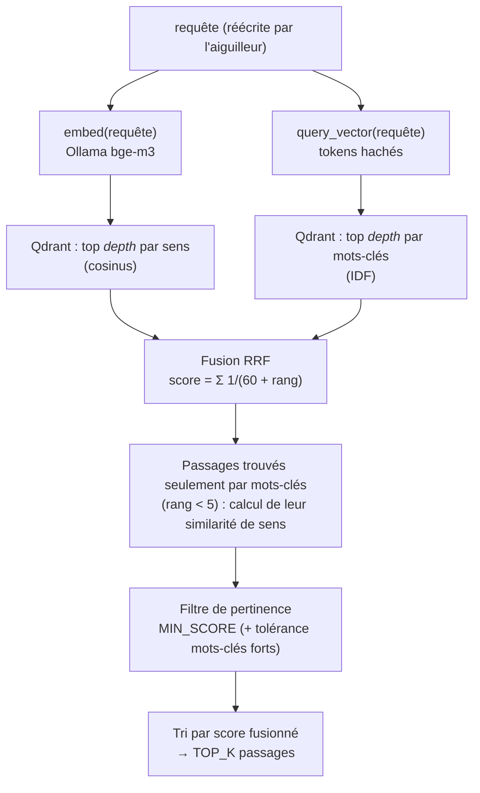

# 07 — Recherche hybride

> [⬅ Précédent : 06 — Extraction](06-extraction.md) · [🏠 Sommaire](README.md) · [Suivant : 08 — Génération d'une réponse ➡](08-generation-reponse.md)

**Sur cette page**
1. [Pourquoi « hybride » ?](#1-pourquoi--hybride--)
2. [L'algorithme en un schéma](#2-lalgorithme-en-un-schéma)
3. [Les deux recherches parallèles](#3-les-deux-recherches-parallèles)
4. [Fusion RRF](#4-fusion-rrf)
5. [Filtre de pertinence](#5-filtre-de-pertinence)
6. [Exemple chiffré](#6-exemple-chiffré)
7. [Réglages](#7-réglages)

Fichiers concernés : `retrieval.py`, `sparse.py`, `qdrant.py`.

---

## 1. Pourquoi « hybride » ?

| Question | Recherche par **sens** seule | Recherche par **mots-clés** seule |
|---|---|---|
| « Quand ai-je quitté ACME ? » (le CV dit « de 2019 à 2022 chez ACME ») | ✅ comprend « quitter » ≈ « jusqu'en » | ⚠️ trouve « ACME », pas le sens |
| « Facture FA-2026-0042 » | ❌ un numéro n'a pas de « sens » | ✅ correspondance exacte, mot très rare |
| « What is my degree? » (CV en français) | ✅ bge-m3 est multilingue | ❌ aucun mot commun |

Combiner les deux donne le meilleur des deux mondes.

---

## 2. L'algorithme en un schéma



`depth = max(20, TOP_K × 4)` → 24 candidats par méthode avec `TOP_K=6`.

---

## 3. Les deux recherches parallèles

Lancées simultanément (`asyncio.gather`) :

| | Dense | Creux (mots-clés) |
|---|---|---|
| Requête Qdrant | `POST /points/query {"query": [..1024..], "using": "dense"}` | `POST /points/query {"query": {"indices", "values"}, "using": "sparse"}` |
| Score renvoyé | similarité cosinus (0 à 1) | somme des IDF des mots communs (non borné) |
| Si la requête n'a aucun mot-clé (que des mots vides) | — | recherche sautée (liste vide) |

---

## 4. Fusion RRF

La *Reciprocal Rank Fusion* combine des classements dont les scores ne sont pas comparables (cosinus vs IDF) en n'utilisant **que les rangs** :

```
fused(p) = 1/(60 + rang_dense(p))  +  1/(60 + rang_motsclés(p))
                 (0 si absent)            (0 si absent)
```

- `RRF_K = 60` (valeur standard de la littérature) : atténue l'écart entre le 1er et le 10e.
- Un passage bien classé **dans les deux** listes l'emporte sur un passage excellent dans une seule.

**Passages trouvés uniquement par mots-clés** : ils n'ont pas de similarité de sens connue. Pour ceux classés dans le **top 5** mots-clés, on calcule leur embedding et leur cosinus avec la requête (`_cos`) afin de pouvoir leur appliquer le filtre. Les autres gardent un score de sens de 0.

---

## 5. Filtre de pertinence

Un passage est **gardé** si :

```
score_sens ≥ MIN_SCORE
        OU
(rang_motsclés < 3  ET  score_sens ≥ MIN_SCORE − 0,08)
```

| Situation | Exemple (MIN_SCORE = 0,40) | Gardé ? |
|---|---|---|
| Sens fort | cosinus 0,55 | ✅ |
| Sens moyen, pas de mot-clé | cosinus 0,38 | ❌ |
| Sens moyen, **mot-clé rare dans le top 3** | cosinus 0,34, rang mots-clés 0 | ✅ (0,34 ≥ 0,32) |
| Mot-clé top 3 mais hors sujet | cosinus 0,20, rang 1 | ❌ |

Puis tri par score **fusionné** décroissant, et on garde les `TOP_K` premiers.

**Si aucun passage ne passe le filtre** → l'assistant ne sollicite même pas le LLM : il bascule sur internet (mode Auto) ou répond « aucun passage pertinent » (mode Documents). ➡ [08 — Génération](08-generation-reponse.md#4-route-documents).

---

## 6. Exemple chiffré

Requête : *« montant facture EDF mars »*, `TOP_K=6`, `MIN_SCORE=0,40`.

| Passage | Rang dense | Cosinus | Rang mots-clés | Score fusionné | Filtre | Position finale |
|---|---|---|---|---|---|---|
| facture-edf-03.pdf #0 | 0 | 0,61 | 0 | 1/60 + 1/60 = **0,0333** | ✅ | **1** |
| facture-edf-03.pdf #1 | 2 | 0,52 | 1 | 1/62 + 1/61 = **0,0325** | ✅ | **2** |
| facture-edf-02.pdf #0 | 5 | 0,44 | 2 | 1/65 + 1/62 = **0,0315** | ✅ | **3** |
| releve-banque.pdf #4 | 1 | 0,47 | — | 1/61 = **0,0164** | ✅ | **4** |
| notes-jardin.md #0 | 3 | 0,31 | — | 1/63 = 0,0159 | ❌ (0,31 < 0,40) | écarté |

On voit que `releve-banque.pdf`, 2ᵉ par le sens, passe derrière `facture-edf-02` car ce dernier est confirmé par les deux méthodes.

---

## 7. Réglages

| Variable | Défaut | Effet | Quand la changer |
|---|---|---|---|
| `TOP_K` | 6 | Nombre d'extraits donnés au LLM | ↑ pour des questions transverses (mais contexte plus long, plus lent) |
| `MIN_SCORE` | 0,40 | Seuil de similarité de sens | ↑ (0,45) si hors sujet ; ↓ (0,35) si « rien trouvé » à tort |
| `CHUNK_SIZE` | 1200 | Taille des morceaux | ↓ pour des documents très denses (FAQ), ↑ pour du texte narratif → `make reindex` |
| `CHUNK_OVERLAP` | 200 | Chevauchement | → `make reindex` |
| `EMBED_MODEL` | `bge-m3` | Modèle de sens | Changement = réindexation complète automatique |

💡 `MIN_SCORE` dépend du modèle d'embeddings : 0,40 est calibré pour bge-m3 avec le préfixe de contexte (`Document : … Section : …`).

---

> [⬅ Précédent : 06 — Extraction](06-extraction.md) · [🏠 Sommaire](README.md) · [Suivant : 08 — Génération d'une réponse ➡](08-generation-reponse.md)
