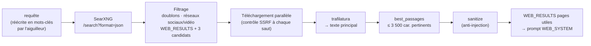
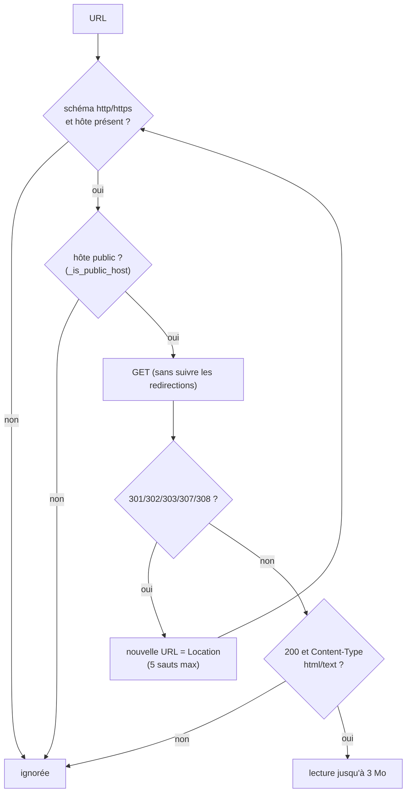

# 09 — Recherche internet

> [⬅ Précédent : 08 — Génération d'une réponse](08-generation-reponse.md) · [🏠 Sommaire](README.md) · [Suivant : 10 — API HTTP ➡](10-api.md)

**Sur cette page**
1. [Pourquoi SearXNG](#1-pourquoi-searxng)
2. [Le pipeline web](#2-le-pipeline-web)
3. [Étape 1 — Recherche](#3-étape-1--recherche)
4. [Étape 2 — Téléchargement sécurisé](#4-étape-2--téléchargement-sécurisé)
5. [Étape 3 — Extraction et sélection des passages](#5-étape-3--extraction-et-sélection-des-passages)
6. [Configuration de SearXNG](#6-configuration-de-searxng)
7. [Ce qui sort de ta machine](#7-ce-qui-sort-de-ta-machine)

Fichiers concernés : `websearch.py`, `searxng/settings.yml`, `safety.py`.

---

## 1. Pourquoi SearXNG

[SearXNG](https://docs.searxng.org) est un **métamoteur** auto-hébergé : il interroge plusieurs moteurs publics (Google, Bing, DuckDuckGo, Wikipedia… selon sa configuration par défaut) et agrège les résultats.

| Avantage | Détail |
|---|---|
| Pas de compte, pas de clé API | rien à configurer, gratuit |
| Pas de profilage par un fournisseur unique | les requêtes sont réparties entre moteurs, sans cookies |
| Sortie JSON | facile à exploiter par le service `rag` |
| Interne | non exposé à l'hôte : seul `rag` l'interroge |

---

## 2. Le pipeline web



---

## 3. Étape 1 — Recherche

```
GET http://searxng:8080/search?q=<requête>&format=json&language=fr&safesearch=0     (délai 20 s)
```

| Règle | Détail |
|---|---|
| Langue | `WEB_LANG` (défaut `fr`) |
| Domaines exclus | `youtube.com`, `youtu.be`, `tiktok.com`, `instagram.com`, `facebook.com`, `x.com`, `twitter.com` (et leurs sous-domaines) : contenu illisible sans JavaScript ou vidéo |
| Doublons d'URL | retirés |
| Nombre de candidats | `WEB_RESULTS + 3` (réserve si des pages sont illisibles) ; `WEB_RESULTS` est borné entre 1 et 8 |
| Erreurs | `WebError` (« SearXNG injoignable », « SearXNG a répondu 5xx ») |

---

## 4. Étape 2 — Téléchargement sécurisé

Chaque page candidate est téléchargée **en parallèle** (délai global 15 s par page, connexion 5 s, lecture 10 s).



🔒 **Protection SSRF** (`_is_public_host`) — un hôte est refusé si :
- il est vide, sans point (`localhost`, `qdrant`, `rag`…) ;
- il finit par `.local`, `.internal`, `.lan`, `.home`, `.localhost` ;
- son nom ne se résout pas ;
- **une** de ses adresses IP résolues n'est pas globale (`127.0.0.0/8`, `10.0.0.0/8`, `172.16.0.0/12`, `192.168.0.0/16`, `169.254.0.0/16`, `::1`, `fc00::/7`…).

Les redirections sont suivies **à la main** pour revérifier **chaque** destination : une page publique ne peut pas rediriger vers `http://qdrant:6333` ou ta box.

En-têtes envoyés : un User-Agent de navigateur Chrome/Linux et `Accept-Language: fr-FR,fr;q=0.9,en;q=0.7`.

---

## 5. Étape 3 — Extraction et sélection des passages

1. **Texte principal** : `trafilatura.extract` (tables incluses, commentaires exclus, mode « rappel »). Repli : suppression des balises `script/style/nav/footer/header/aside` puis de toutes les balises.
2. **Page trop courte** (< 200 caractères, typiquement un site qui exige JavaScript ou bloque les robots) → on utilise le **résumé fourni par le moteur** (`snippet`).
3. **Sélection** (`best_passages`) si la page dépasse 3 500 caractères :
   ```
   score(paragraphe) = (nb de mots de la requête présents) / (1 + √nb de mots du paragraphe)
                       + 0,3 si c'est l'un des 3 premiers paragraphes
   ```
   On prend les meilleurs paragraphes (> 30 caractères) jusqu'à 3 500 caractères, **réordonnés dans l'ordre d'origine**.
4. **Anti-injection** : `sanitize()` ; si une phrase suspecte est trouvée, la page est marquée `suspicious` → avertissement dans la réponse.
5. On garde les `WEB_RESULTS` premières pages **non vides**.

Format envoyé au LLM :
```xml
<source n="1" titre="Prévisions météo Kourou - Météo-France" url="https://…">
…texte sélectionné…
</source>
```

---

## 6. Configuration de SearXNG

`searxng/settings.yml` (monté en lecture seule) :

| Clé | Valeur | Pourquoi |
|---|---|---|
| `use_default_settings` | `true` | moteurs par défaut de SearXNG |
| `server.limiter` | `false` | instance privée : pas de limitation de débit |
| `server.public_instance` | `false` | |
| `server.image_proxy` | `false` | inutile |
| `search.formats` | `html`, `json` | **json requis** par le service `rag` |
| `search.default_lang` | `fr` | |
| `outgoing.request_timeout` / `max_request_timeout` | 4 s / 8 s | réponses rapides |
| `general.enable_metrics` | `false` | |
| Clé secrète | `SEARXNG_SECRET` (`.env`) | |

💡 Si la recherche web revient vide : `make logs s=searxng` — des moteurs peuvent être temporairement bloqués (captcha, limitation). Ils se rétablissent généralement seuls.

---

## 7. Ce qui sort de ta machine

| Donnée | Sort ? | Vers |
|---|---|---|
| Tes documents | ❌ jamais | — |
| Tes conversations | ❌ jamais | — |
| La **requête** (réécrite en mots-clés) | ✅ en route web uniquement | moteurs interrogés par SearXNG |
| Requêtes HTTP vers les pages lues | ✅ en route web uniquement | sites des résultats |

Pour **couper** complètement internet : `WEB_SEARCH=off` dans `.env` puis `make up`. Pour une seule question : `/doc …` ou le mode 📄.

---

> [⬅ Précédent : 08 — Génération d'une réponse](08-generation-reponse.md) · [🏠 Sommaire](README.md) · [Suivant : 10 — API HTTP ➡](10-api.md)
