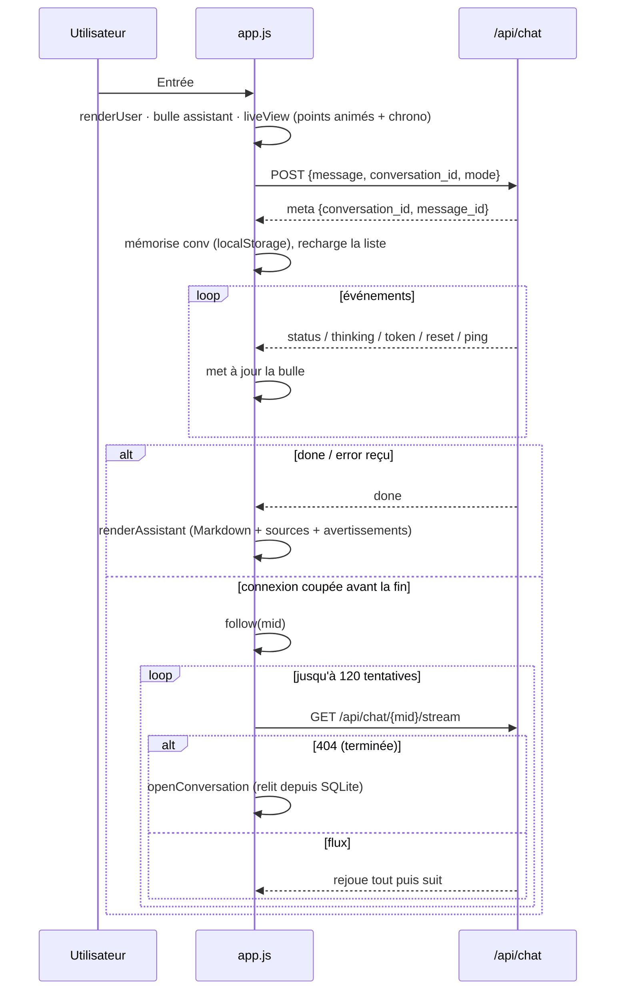

# 11 — Interface web

> [⬅ Précédent : 10 — API HTTP](10-api.md) · [🏠 Sommaire](README.md) · [Suivant : 12 — Données et stockage ➡](12-donnees.md)

**Sur cette page**
1. [Fichiers et choix techniques](#1-fichiers-et-choix-techniques)
2. [Structure de la page](#2-structure-de-la-page)
3. [État côté client](#3-état-côté-client)
4. [Envoi, streaming et reprise après coupure](#4-envoi-streaming-et-reprise-après-coupure)
5. [Rendu des sources et des citations](#5-rendu-des-sources-et-des-citations)
6. [Onglet Documents](#6-onglet-documents)
7. [Rendu Markdown et sécurité](#7-rendu-markdown-et-sécurité)
8. [Thème et responsive](#8-thème-et-responsive)

Fichiers concernés : `app/rag/static/index.html`, `app.js` (~560 lignes), `style.css` (~210 lignes).

---

## 1. Fichiers et choix techniques

| Choix | Raison |
|---|---|
| **JavaScript natif**, sans framework ni build | rien à compiler, aucune dépendance, compatible CSP stricte (`default-src 'self'`) |
| Pas de bibliothèque externe (pas de CDN) | fonctionne hors ligne, aucune fuite vers un tiers |
| Authentification HTTP Basic native du navigateur | pas de page de login à maintenir ; `credentials: "same-origin"` sur tous les `fetch` |
| Streaming via `fetch` + `ReadableStream` (NDJSON) | plus simple que WebSocket/SSE, fonctionne avec l'auth Basic et en POST |
| Mini-moteur Markdown maison | contrôle total de l'échappement HTML (sécurité) |

---

## 2. Structure de la page

```
#app
├── aside#sidebar
│   ├── #newChat           ＋ Nouvelle conversation
│   ├── nav#convs          liste groupée des conversations
│   └── side-foot
│       ├── #openDocs      📁 Documents (#docCount)
│       └── #health        état des services
├── .scrim                 voile (mobile, barre ouverte)
└── main
    ├── header.topbar      ☰ #toggleSide · h1#title · 📁 #openDocs2
    ├── section#chatView
    │   ├── #messages      (aria-live="polite")
    │   └── form#composer  textarea#input · select#mode · #hint · button#send
    └── section#docsView   (masquée par défaut)
        ├── #syncBtn · #reindexBtn · #closeDocs
        ├── label#drop     input#fileInput (multiple)
        ├── #progress
        └── #docList
template#tplMsg            article.msg > .bubble
```

---

## 3. État côté client

```js
const state = { conv: null, busy: false, currentMid: null, docsTimer: null };
```

| Donnée | Où | Durée |
|---|---|---|
| Conversation ouverte (`conv`) | `localStorage["conv"]` | rouverte au rechargement |
| Mode choisi (`mode`) | `localStorage["mode"]` | persistant |
| Réponse en cours (`currentMid`) | mémoire | le temps de la réponse |
| Rafraîchissement état | `setInterval(health, 15 000)` | permanent |
| Rafraîchissement documents | `setInterval(loadDocs, 3 000)` | tant que l'onglet Documents est ouvert |

Tous les accès à `localStorage` sont protégés par `try/catch` (navigation privée).

---

## 4. Envoi, streaming et reprise après coupure



| Situation | Comportement |
|---|---|
| Onglet fermé pendant une réponse | la génération continue côté serveur ; à la réouverture, `openConversation` voit `live: true` et appelle `follow()` |
| Message `pending` mais plus `live` | affiché « ⚠️ Réponse interrompue. » |
| Réseau coupé | nouvelles tentatives toutes les 2–3 s (120 max) |
| Bouton ⏹ Arrêter | `POST /api/chat/{mid}/stop` |
| `reset` reçu (bascule docs → web) | le texte partiel est effacé |

**`liveView`** affiche, tant qu'aucun texte n'est arrivé : trois points animés, le statut (« Je cherche… »), « (réflexion du modèle) » si `thinking`, et le chronomètre en secondes. Dès le premier `token`, le Markdown est rendu au fil de l'eau avec un curseur.

---

## 5. Rendu des sources et des citations

```
┌──────────────────────────────────────────────────────────────┐
│ [📄 Mes documents]                                           │  ← badge (route)
│ Ton contrat se termine le 31 août 2027 [1].                  │  ← [1] = button.cite
│ ┌──────────────────────────────────────────────────────────┐ │
│ │ ① contrat-travail.pdf  page 3 · « Durée du contrat »     │ │  ← sources citées
│ │   ┊ extrait (masqué, s'affiche au clic)                  │ │
│ │ ▸ 3 autre(s) source(s) consultée(s)                      │ │  ← <details> repliée
│ └──────────────────────────────────────────────────────────┘ │
│ ⚠️ 1 référence(s) vers un extrait inexistant retirée(s).     │  ← warnings
│ 🔎 À vérifier : 1 250 n'apparaît dans aucune source…         │  ← unverified
│ 18.4 s · recherche : « date de fin du contrat de travail »   │  ← meta-line
└──────────────────────────────────────────────────────────────┘
```

| Interaction | Effet |
|---|---|
| Clic sur `[1]` dans le texte | ouvre le `<details>` si besoin, défile jusqu'à la source, la fait clignoter, affiche l'extrait |
| Clic sur la pastille ① de la source | affiche / masque l'extrait |
| Clic sur le nom du fichier | ouvre `/api/documents/file?path=…#page=N` (le visionneur PDF du navigateur saute à la page) |
| Source web | lien externe `rel="noopener noreferrer"`, domaine affiché |

Si **aucune** source n'est citée, la liste « Sources consultées (N) » est ouverte par défaut.

---

## 6. Onglet Documents

| Élément | Comportement |
|---|---|
| Zone de dépôt | glisser-déposer ou clic (sur mobile : appareil photo proposé) → `POST /api/documents` (multipart) |
| Barre de progression | « ⬆ Envoi… », puis « ⟳ Indexation : 3/5 — fichier (les photos et scans prennent environ une minute) », puis « ✔ bilan » pendant 2 min |
| Liste | ✅ ok · ⚪ vide · ⚠️ erreur ; détail : morceaux · pages · méthode · taille · date |
| 🗑 | confirmation puis `DELETE /api/documents?path=` |
| ⟳ Synchroniser | `POST /api/index {}` |
| Tout réindexer | confirmation puis `POST /api/index {"full": true}` |

---

## 7. Rendu Markdown et sécurité

Le mini-moteur `markdown()` prend en charge : titres (rendus en `h2`–`h4`), **gras**, *italique*, `code` en ligne et blocs ```` ``` ````, listes à puces et numérotées (avec un niveau d'imbrication), tableaux, citations `>`, liens `[texte](https://…)` et URL nues, renvois `[n]` (transformés en `<button class="cite">`).

🔒 **Tout le texte est échappé** (`esc()` : `& < > " '`) **avant** d'être transformé en HTML : un document ou une page web contenant `<script>` ne peut rien exécuter. Les liens ne sont générés que pour des URL `http(s)` (pas de `javascript:`), et s'ouvrent dans un nouvel onglet avec `rel="noopener noreferrer"`. La CSP du serveur (`default-src 'self'`) bloque de toute façon les scripts injectés et externes.

---

## 8. Thème et responsive

- Couleurs en **variables CSS** (`--bg`, `--panel`, `--accent: #2f6f5e`, `--web: #2b5d9b`…) redéfinies sous `@media (prefers-color-scheme: dark)` → **thème sombre automatique**.
- Écran étroit (≤ 820 px) : la barre latérale devient un tiroir (☰ + voile), et `Entrée` insère un retour à la ligne (envoi par le bouton).
- `viewport-fit=cover` : compatible encoche des téléphones.
- La zone de saisie s'agrandit avec le texte (jusqu'à 40 % de la hauteur d'écran).

---

> [⬅ Précédent : 10 — API HTTP](10-api.md) · [🏠 Sommaire](README.md) · [Suivant : 12 — Données et stockage ➡](12-donnees.md)
