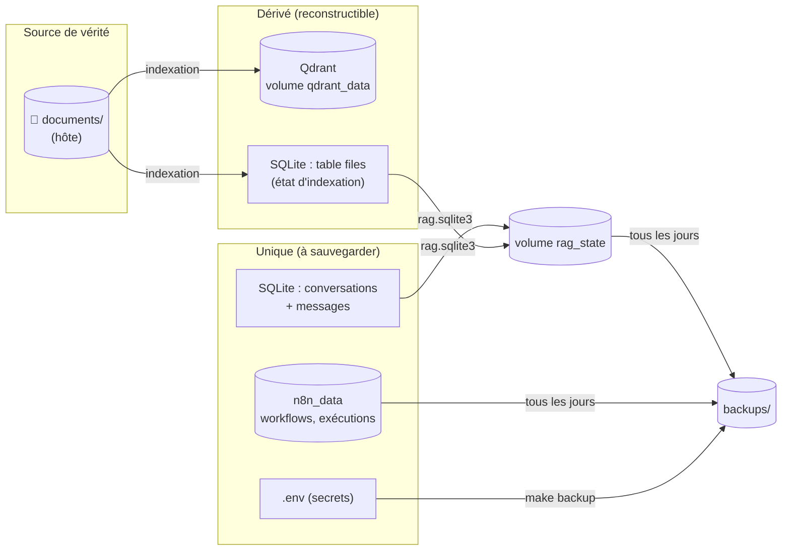
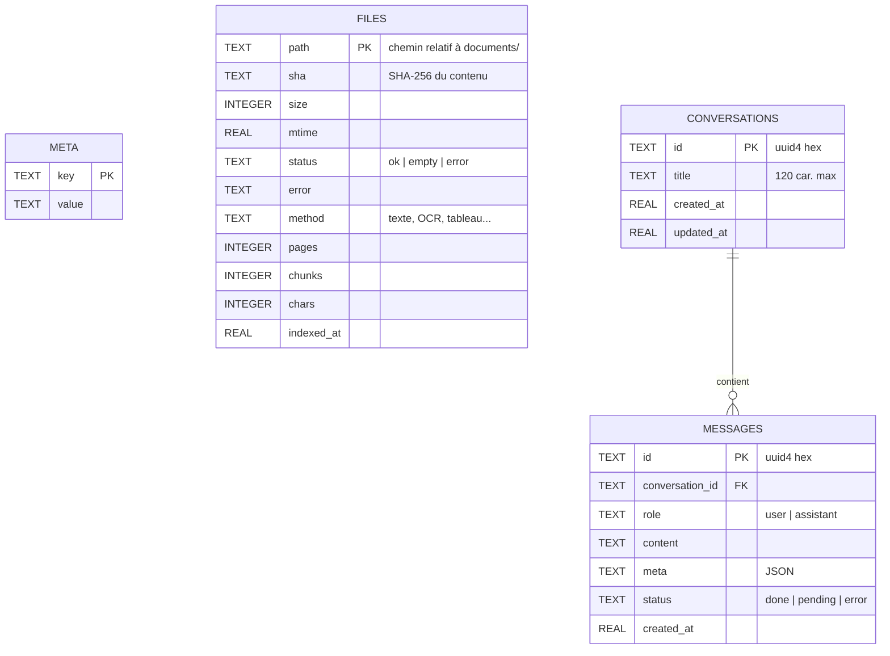

# 12 — Données et stockage

> [⬅ Précédent : 11 — Interface web](11-interface-web.md) · [🏠 Sommaire](README.md) · [Suivant : 13 — Sécurité ➡](13-securite.md)

**Sur cette page**
1. [Carte des données](#1-carte-des-données)
2. [Base SQLite `rag.sqlite3`](#2-base-sqlite-ragsqlite3)
3. [Collection Qdrant `documents`](#3-collection-qdrant-documents)
4. [Le dossier `documents/`](#4-le-dossier-documents)
5. [Données n8n](#5-données-n8n)
6. [Sauvegardes](#6-sauvegardes)
7. [Que se passe-t-il si je perds quelque chose](#7-que-se-passe-t-il-si-je-perds-quelque-chose)

---

## 1. Carte des données



| Donnée | Emplacement | Reconstructible ? |
|---|---|---|
| Documents originaux | `./documents/` | ❌ — **à sauvegarder toi-même** |
| Vecteurs + texte des morceaux | volume `mon-rag_qdrant_data` | ✅ depuis `documents/` |
| État d'indexation | `rag.sqlite3` → `files`, `meta` | ✅ |
| Conversations | `rag.sqlite3` → `conversations`, `messages` | ❌ → sauvegarde auto |
| Workflows et historique n8n | volume `mon-rag_n8n_data` | ❌ → sauvegarde auto |
| Configuration et secrets | `.env` | ❌ → `make backup` le copie |

---

## 2. Base SQLite `rag.sqlite3`

Chemin dans le conteneur : `/data/state/rag.sqlite3` (`DATA_DIR`). Mode **WAL** (lectures concurrentes), clés étrangères activées, accès sérialisé par un verrou (`threading.RLock`), *autocommit*.



Index : `idx_messages_conv (conversation_id, created_at)`.

| Table | Contenu clé |
|---|---|
| `meta` | `embed_model` = modèle d'embeddings ayant servi à construire l'index (détection de changement) |
| `files` | une ligne par fichier vu (même en erreur) |
| `conversations` | `updated_at` mis à jour à chaque message → tri de la barre latérale |
| `messages` | `meta` (JSON) : pour l'utilisateur `{"mode": "auto"}` ; pour l'assistant `route`, `sources`, `warnings`, `unverified`, `query`, `seconds`, `fallback` |

**Cycle de vie d'un message assistant :**
```
pending (contenu vide) ──► done  (contenu final + meta)
                       └─► error (texte partiel + message d'erreur, meta {"route": "error"})
au redémarrage du service : pending ──► error « ⚠️ Réponse interrompue (redémarrage du service). »
```

💡 Consulter la base :
```bash
docker compose exec rag python -c "import sqlite3;c=sqlite3.connect('/data/state/rag.sqlite3');print(c.execute('select count(*) from messages').fetchone())"
```

---

## 3. Collection Qdrant `documents`

Nom : `QDRANT_COLLECTION` (défaut `documents`).

| Élément | Configuration |
|---|---|
| Vecteur nommé `dense` | taille = dimension du modèle (1024 pour bge-m3), distance **Cosine** |
| Vecteur creux nommé `sparse` | `modifier: idf` (Qdrant calcule la rareté des mots) |
| Payload | sur disque (`on_disk_payload`) |
| Index de payload | `path` (keyword), `chunk` (integer) |

Un **point** = un morceau :
```json
{
  "id": "uuid5(NS, 'ajouts/cv.pdf\\x00<sha>\\x003')",
  "vector": {
    "dense": [0.012, -0.034, …],
    "sparse": {"indices": [10234, 99812, …], "values": [1.0, 1.69, …]}
  },
  "payload": {
    "path": "ajouts/cv.pdf", "name": "cv.pdf", "sha": "9f2c…", "chunk": 3,
    "page": 1, "label": "", "heading": "Formation",
    "text": "Master informatique à l'Université de Guyane, obtenu en 2018.",
    "method": "texte"
  }
}
```

Opérations utilisées (`qdrant.py`) : création/suppression de collection, `count`, `upsert` (lots de 64, `wait=true`), `delete` par filtre (`path` = X et `sha` ≠ Y), `scroll` par `path` (pour `/resume`, 5 000 morceaux max), `query` dense et creux.

🔒 Accès protégé par `QDRANT_API_KEY` et non exposé hors du réseau Docker.

---

## 4. Le dossier `documents/`

- Monté en lecture-écriture dans `rag` (`/data/documents`), car l'interface peut **ajouter** (`ajouts/`) et **supprimer** des fichiers.
- Le conteneur tourne avec **ton UID/GID** : les fichiers déposés t'appartiennent et sont modifiables depuis l'hôte.
- Organisation libre (sous-dossiers). Les chemins relatifs servent d'identifiants : **renommer = réindexer**.
- Jamais modifiés par l'indexation.

---

## 5. Données n8n

Volume `mon-rag_n8n_data` monté dans `/home/node/.n8n` : base SQLite de n8n (workflows, identifiants **chiffrés** avec `N8N_ENCRYPTION_KEY`, exécutions conservées **7 jours** — `EXECUTIONS_DATA_MAX_AGE=168` h), fichier marqueur `.rag-workflows-version`.

⚠️ Perdre `N8N_ENCRYPTION_KEY` rend les identifiants stockés dans n8n illisibles : garde le `.env` avec tes sauvegardes.

---

## 6. Sauvegardes

| Type | Déclencheur | Contenu | Fichier | Rétention |
|---|---|---|---|---|
| **Automatique** | service `backup`, vérifie toutes les heures, 1 archive/jour | `rag/` (SQLite) + `n8n/` | `backups/auto-AAAAMMJJ.tar.gz` | `BACKUP_KEEP_DAYS` (7 j) |
| **Manuelle** | `make backup` | idem + copie du `.env` | `backups/manuel-AAAAMMJJ-HHMMSS.tar.gz` + `.env` | illimitée |

Détails de la boucle (`scripts/backup-loop.sh`) :
- `umask 077` → archives lisibles par toi seul ; dossier `backups/` en `700` ;
- écriture dans `….tmp` puis renommage (pas d'archive tronquée) ;
- si l'archive du jour existe déjà et n'est pas vide, rien n'est fait ;
- suppression des `auto-*.tar.gz` plus vieux que `BACKUP_KEEP_DAYS` jours.

⚠️ La copie à chaud de SQLite (mode WAL) est en pratique fiable pour une base peu active, mais pour une sauvegarde parfaitement cohérente, fais `make down` avant `make backup`.

➡ Restauration : [16 — Exploitation](16-exploitation.md#3-sauvegarde-et-restauration).

---

## 7. Que se passe-t-il si je perds quelque chose

| Perte | Conséquence | Récupération |
|---|---|---|
| Volume Qdrant | Recherche vide un instant | Automatique : détecté au prochain passage → réindexation complète |
| `rag.sqlite3` | Conversations perdues ; état d'index perdu | `make restore B=…` ; sinon l'index est reconstruit (fichiers revus) |
| Volume n8n | Workflows, compte | `make restore`, ou `make up` (réimport des workflows du projet + compte recréé) |
| `.env` | Nouveaux secrets générés au prochain `make` | Restaurer `backups/manuel-….env` ; sinon refaire `make n8n-setup`, les identifiants n8n stockés sont perdus |
| `documents/` | **Perte définitive** des originaux | Tes propres sauvegardes uniquement |

💡 Pour effacer **volontairement** toutes ces données d'un coup (avant de publier le projet) : `make purge` ➡ [16 §8](16-exploitation.md#8-effacer-toutes-les-données-perso-et-publier-sur-github).

---

> [⬅ Précédent : 11 — Interface web](11-interface-web.md) · [🏠 Sommaire](README.md) · [Suivant : 13 — Sécurité ➡](13-securite.md)
