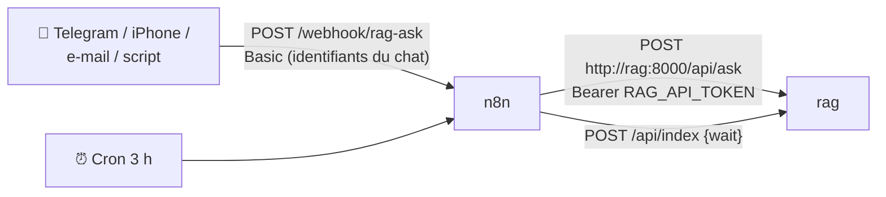
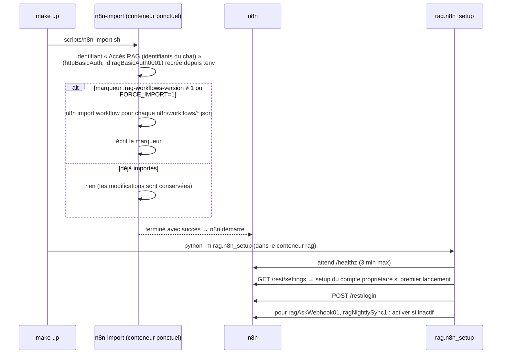

# 14 — Automatisations n8n

> [⬅ Précédent : 13 — Sécurité](13-securite.md) · [🏠 Sommaire](README.md) · [Suivant : 15 — Configuration ➡](15-configuration.md)

**Sur cette page**
1. [Rôle de n8n dans le projet](#1-rôle-de-n8n-dans-le-projet)
2. [Mise en place automatique](#2-mise-en-place-automatique)
3. [Workflow Question par webhook](#3-workflow-question-par-webhook)
4. [Workflow Vérification nocturne](#4-workflow-vérification-nocturne)
5. [Créer tes propres workflows](#5-créer-tes-propres-workflows)
6. [Idées d'automatisations](#6-idées-dautomatisations)
7. [Commandes utiles](#7-commandes-utiles)

---

## 1. Rôle de n8n dans le projet

[n8n](https://n8n.io) est un outil d'automatisation visuel (nœuds reliés). Il est **facultatif** : le chat fonctionne sans lui. Il sert de **passerelle** entre l'assistant et le reste du monde (messageries, e-mails, tâches planifiées).

- Interface : **http://localhost:5678** (`N8N_OWNER_EMAIL` / `N8N_OWNER_PASSWORD` du `.env`)
- Version : `2.45.7` (`N8N_VERSION`)



---

## 2. Mise en place automatique



| Fichier | Rôle |
|---|---|
| `scripts/n8n-import.sh` | identifiants + import des workflows (une fois par version `VERSION=1`) |
| `app/rag/n8n_setup.py` | compte propriétaire + activation (n'échoue **jamais** `make up`) |
| `n8n/workflows/*.json` | définitions des workflows (importés **inactifs**, activés ensuite) |

Si le compte n8n a été créé à la main avec d'autres identifiants, `n8n_setup` le signale et te demande d'activer les workflows toi-même.

---

## 3. Workflow Question par webhook

ID : `ragAskWebhook01` · fichier : `n8n/workflows/rag-question-webhook.json`

```
[Question reçue]  ──►  [Demander au RAG]  ──►  [Renvoyer la réponse]
 Webhook POST            HTTP POST                Respond to Webhook
 /webhook/rag-ask        {{$env.RAG_URL}}/api/ask (premier élément)
 auth Basic              Bearer {{$env.RAG_API_TOKEN}}
```

**Appel :**
```bash
curl -u moi:<CHAT_PASSWORD> -X POST http://localhost:5678/webhook/rag-ask \
     -H 'content-type: application/json' \
     -d '{"question": "Quand se termine mon contrat ?"}'
```
Le nœud *Demander au RAG* transmet à `/api/ask` le champ `question` du corps JSON (alias accepté : `q`) et `mode` (défaut `auto` ; `docs`, `web`, `chat` possibles). Délai d'attente du nœud : 15 min.

**Réponse :** le JSON de [`/api/ask`](10-api.md#8-question-simple-json) : `ok`, `answer`, `route`, `sources`, `warnings`, `unverified_numbers`, `seconds`.

⏱️ Sur CPU, compte 20 s à 2 min : configure un délai d'attente suffisant côté appelant.

---

## 4. Workflow Vérification nocturne

ID : `ragNightlySync1` · fichier : `n8n/workflows/rag-synchro-nocturne.json`

```
[Chaque nuit à 3 h] ─┐
  cron 0 3 * * *     ├─► [Synchroniser documents/] ──► [État du service]
[Lancer à la main] ──┘    POST /api/index {"wait": true}   GET /api/status
                          délai max 1 h
```

Filet de sécurité en plus de la surveillance toutes les 30 s (par ex. si des fichiers ont été modifiés pendant que le service était arrêté). Fuseau : `TIMEZONE` (`GENERIC_TIMEZONE`).

---

## 5. Créer tes propres workflows

Dans n8n, ajoute un nœud **HTTP Request** :

| Paramètre | Valeur |
|---|---|
| Méthode | `POST` |
| URL | `{{ $env.RAG_URL }}/api/ask` (= `http://rag:8000/api/ask`) |
| En-tête | `Authorization` = `Bearer {{ $env.RAG_API_TOKEN }}` |
| Corps JSON | `{"question": "…", "mode": "docs"}` |
| Délai | ≥ 300 000 ms |

Variables d'environnement disponibles dans n8n : `RAG_URL`, `RAG_API_TOKEN`, `CHAT_USER`, `CHAT_PASSWORD` (`N8N_BLOCK_ENV_ACCESS_IN_NODE=false`).

Autres routes utiles : `POST /api/index` (synchro), `GET /api/status`, `GET /api/documents`. ➡ [10 — API](10-api.md).

Pour **ajouter un document** depuis n8n (pièce jointe d'e-mail…), utilise `POST /api/documents` en multipart (champ `files`).

---

## 6. Idées d'automatisations

| Idée | Nœuds |
|---|---|
| Bot Telegram qui répond depuis tes documents | Telegram Trigger → HTTP `/api/ask` → Telegram (send message) |
| Raccourci iPhone « Demander à mes docs » | Raccourci « Obtenir le contenu de l'URL » → webhook `rag-ask` |
| Classer automatiquement les factures reçues par e-mail | IMAP Trigger → HTTP `POST /api/documents` (pièce jointe) |
| Rappel des échéances de contrats | Cron hebdo → `/api/ask` « Quelles échéances dans les 30 prochains jours ? » mode `docs` → e-mail |
| Alerte si l'indexation a des erreurs | Cron → `/api/status` → IF `documents_errors > 0` → notification |

---

## 7. Commandes utiles

| Commande | Effet |
|---|---|
| `make n8n` | ouvre n8n dans le navigateur |
| `make n8n-setup` | recrée le compte et réactive les workflows du projet |
| `make n8n-import` | ⚠️ **réimporte** les workflows du projet (écrase tes modifications de ces deux workflows), redémarre n8n, réactive |
| `make logs s=n8n` | journaux |

---

> [⬅ Précédent : 13 — Sécurité](13-securite.md) · [🏠 Sommaire](README.md) · [Suivant : 15 — Configuration ➡](15-configuration.md)
