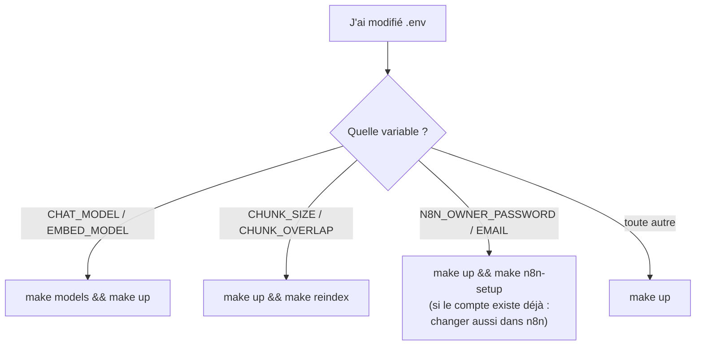

# 15 — Configuration (`.env`)

> [⬅ Précédent : 14 — Automatisations n8n](14-n8n.md) · [🏠 Sommaire](README.md) · [Suivant : 16 — Exploitation ➡](16-exploitation.md)

**Sur cette page**
1. [Comment la configuration circule](#1-comment-la-configuration-circule)
2. [Modèles (Ollama)](#2-modèles-ollama)
3. [Recherche dans les documents](#3-recherche-dans-les-documents)
4. [Internet](#4-internet)
5. [Accès et réseau](#5-accès-et-réseau)
6. [n8n](#6-n8n)
7. [Divers et versions](#7-divers-et-versions)
8. [Variables internes (non présentes dans `.env`)](#8-variables-internes-non-présentes-dans-env)
9. [Quelle action après une modification ?](#9-quelle-action-après-une-modification-)
10. [Profils prêts à l'emploi](#10-profils-prêts-à-lemploi)

---

## 1. Comment la configuration circule

```mermaid
flowchart LR
    EX[".env.example<br/>(modèle versionné)"] -->|scripts/env.sh<br/>génère les secrets| ENV[".env"]
    ENV -->|interpolation ${VAR:-défaut}| DC["docker-compose.yml"]
    DC -->|environment:| C["conteneurs"]
    C -->|os.environ| CFG["config.py<br/>Settings()"]
    ENV -->|lu directement| SH["scripts/ollama-host.sh<br/>Makefile (ENVV)"]
```

- Les valeurs par défaut existent à **trois** niveaux (`.env.example`, `docker-compose.yml`, `config.py`) ; ce sont les mêmes.
- `config.py` est tolérant : nombre invalide → valeur par défaut ; `MIN_SCORE=0,45` (virgule) accepté.
- Booléens acceptés : `1`, `true`, `yes`, `oui`, `on`, `auto` = vrai.

---

## 2. Modèles (Ollama)

| Variable | Défaut | Rôle | Notes |
|---|---|---|---|
| `OLLAMA_URL` | `http://host.docker.internal:11434` | Adresse d'Ollama vue du conteneur | |
| `CHAT_MODEL` | `gpt-oss:20b` | LLM des réponses, de l'aiguillage et des résumés | `make models && make up` après changement |
| `EMBED_MODEL` | `bge-m3` | Modèle d'embeddings | changement ⇒ **réindexation complète auto** |
| `OLLAMA_NUM_CTX` | `16384` | Fenêtre de contexte (tokens) | extraits + pages web + réponse doivent y tenir ; ↑ = + RAM ; influence le découpage de `/resume` |
| `OLLAMA_KEEP_ALIVE` | `30m` | Durée de maintien du modèle en mémoire après usage | `-1` = toujours ; `0` = libérer tout de suite |
| `LLM_THINK` | `low` | Niveau de réflexion | `low`/`medium`/`high` pour gpt-oss ; `off` pour qwen3 (plus rapide) |
| `LLM_TEMPERATURE` | `0.2` | Créativité | bas = factuel ; l'aiguillage utilise toujours 0 |

**Choisir un modèle :**

| Modèle | RAM | Vitesse CPU | Réglage |
|---|---|---|---|
| `gpt-oss:20b` (défaut) | ~14 Go | 20–25 mots/s, 10–20 s avant le 1er mot | `LLM_THINK=low` |
| `qwen3:30b-a3b` | ~19 Go | très rapide (MoE 3 Md actifs) | `LLM_THINK=off` |
| `qwen3:8b` | ~6 Go | correct | `LLM_THINK=off` — pour ≤ 16 Go de RAM |

---

## 3. Recherche dans les documents

| Variable | Défaut | Rôle | Après modification |
|---|---|---|---|
| `CHUNK_SIZE` | `1200` | Taille cible d'un morceau (caractères) | `make up` **puis** `make reindex` |
| `CHUNK_OVERLAP` | `200` | Chevauchement entre morceaux | `make up` puis `make reindex` |
| `TOP_K` | `6` | Extraits donnés au LLM | `make up` |
| `MIN_SCORE` | `0.40` | Pertinence minimale (0–1) | `make up` |
| `MEMORY_TURNS` | `4` | Échanges d'historique (×2 messages) pour l'aiguillage et le mode chat | `make up` |
| `QUERY_ROUTER` | `1` | `1` = aiguillage LLM ; `0` = toujours documents (économise un appel LLM) | `make up` |
| `INDEX_INTERVAL` | `30` | Période de surveillance de `documents/` (s, min 5) | `make up` |
| `OCR_LANGS` | `fra+eng` | Langues Tesseract | seules `fra` et `eng` sont installées ; en ajouter = modifier le `Dockerfile` |
| `MAX_FILE_MB` | `200` | Taille max d'un fichier (dépôt et indexation) | `make up` |
| `QDRANT_COLLECTION` | `documents` | Nom de la collection | changer = nouvel index vide |

➡ Effet précis de `TOP_K`/`MIN_SCORE` : [07 — Recherche hybride](07-recherche-hybride.md#7-réglages).

---

## 4. Internet

| Variable | Défaut | Rôle |
|---|---|---|
| `WEB_SEARCH` | `auto` | `off` / `0` / `false` / `non` / `no` = jamais d'internet (même en mode 🌐 : bascule sur les documents) |
| `WEB_RESULTS` | `4` | Pages lues par question (borné 1–8) |
| `WEB_LANG` | `fr` | Langue demandée à SearXNG |
| `SEARXNG_SECRET` | *(généré)* | Clé secrète de SearXNG |

---

## 5. Accès et réseau

| Variable | Défaut | Rôle |
|---|---|---|
| `CHAT_USER` | `moi` | Identifiant du chat |
| `CHAT_PASSWORD` | *(généré)* | Mot de passe du chat (et du webhook n8n) |
| `RAG_API_TOKEN` | *(généré)* | Jeton Bearer pour scripts / n8n / CLI |
| `BIND_ADDR` | `127.0.0.1` | Interface de publication des ports 8000 et 5678 (`0.0.0.0` = réseau local) |
| `RAG_PORT` | `8000` | Port du chat sur l'hôte |
| `N8N_PORT` | `5678` | Port de n8n sur l'hôte |
| `N8N_PUBLIC_URL` | `http://localhost:5678` | URL publique de n8n (éditeur, webhooks) |
| `DNS_1`, `DNS_2` | `1.1.1.1`, `9.9.9.9` | Résolveurs DNS des conteneurs `rag`, `searxng`, `n8n` |

---

## 6. n8n

| Variable | Défaut | Rôle |
|---|---|---|
| `N8N_OWNER_EMAIL` | `admin@rag.local` | Compte propriétaire |
| `N8N_OWNER_PASSWORD` | *(généré)* | Mot de passe du compte |
| `N8N_ENCRYPTION_KEY` | *(généré)* | Chiffrement des identifiants stockés — **ne pas perdre** |
| `N8N_JWT_SECRET` | *(généré)* | Sessions |
| `N8N_VERSION` | `2.45.7` | Version de l'image |

Variables n8n fixées dans `docker-compose.yml` : diagnostics/personnalisation/notifications désactivés, cookie non sécurisé (HTTP), accès à `$env` autorisé, API publique désactivée, *task runners* activés, exécutions purgées après 168 h, pool SQLite de 2.

---

## 7. Divers et versions

| Variable | Défaut | Rôle |
|---|---|---|
| `QDRANT_API_KEY` | *(généré)* | Clé d'accès à Qdrant |
| `TIMEZONE` | `America/Cayenne` (`.env.example`) / `Europe/Paris` (repli) | Date dans les prompts, cron n8n, horodatage des sauvegardes |
| `BACKUP_KEEP_DAYS` | `7` | Rétention des sauvegardes automatiques |
| `HOST_UID`, `HOST_GID` | *(ton utilisateur)* | Utilisateur des conteneurs `rag` et `backup` |
| `QDRANT_VERSION` | `v1.13.4` | Image Qdrant |
| `SEARXNG_VERSION` | `latest` | Image SearXNG |

---

## 8. Variables internes (non présentes dans `.env`)

Fixées par `docker-compose.yml` ou le `Dockerfile` :

| Variable | Valeur | Où |
|---|---|---|
| `QDRANT_URL` | `http://qdrant:6333` | rag |
| `SEARXNG_URL` | `http://searxng:8080` | rag |
| `N8N_INTERNAL_URL` | `http://n8n:5678` | rag (pour `n8n_setup`) |
| `DOCS_DIR` | `/data/documents` | rag (défaut de `config.py`) |
| `DATA_DIR` | `/data/state` | rag (défaut de `config.py`) |
| `TZ` | `= TIMEZONE` | rag, n8n, backup |
| `PYTHONUNBUFFERED`, `OMP_THREAD_LIMIT` | `1`, `4` | Dockerfile |
| `RAG_URL` | `http://rag:8000` | n8n |

Constantes dans le code (modifiables en éditant le source) :

| Constante | Valeur | Fichier |
|---|---|---|
| `RRF_K` | 60 | `retrieval.py` |
| `OCR_MIN_CHARS` | 40 | `extract.py` |
| `MAX_SHEET_ROWS` | 5 000 | `extract.py` |
| `PAGE_CHARS` | 3 500 | `websearch.py` |
| `MAX_BYTES` (page web) | 3 000 000 | `websearch.py` |
| `SKIP_DOMAINS` | YouTube, TikTok, Instagram, Facebook, X/Twitter | `websearch.py` |
| `IGNORED_DIRS` | `_ocr`, `__pycache__`, `node_modules`, `lost+found` | `indexer.py` |
| Lots d'embeddings / upsert | 16 / 64 | `llm.py` / `qdrant.py` |

---

## 9. Quelle action après une modification ?



💡 `make up` recrée uniquement les conteneurs dont la configuration a changé.

---

## 10. Profils prêts à l'emploi

| Profil | Réglages |
|---|---|
| **Machine 16 Go** | `CHAT_MODEL=qwen3:8b`, `LLM_THINK=off`, `OLLAMA_NUM_CTX=8192` |
| **Rapidité maximale** | `CHAT_MODEL=qwen3:30b-a3b`, `LLM_THINK=off`, `QUERY_ROUTER=0`, `TOP_K=4` |
| **Confidentialité totale** | `WEB_SEARCH=off`, `BIND_ADDR=127.0.0.1` |
| **Documents denses (FAQ, fiches)** | `CHUNK_SIZE=700`, `CHUNK_OVERLAP=120`, `TOP_K=8` puis `make reindex` |
| **Accès téléphone (réseau de confiance)** | `BIND_ADDR=0.0.0.0` |

---

> [⬅ Précédent : 14 — Automatisations n8n](14-n8n.md) · [🏠 Sommaire](README.md) · [Suivant : 16 — Exploitation ➡](16-exploitation.md)
