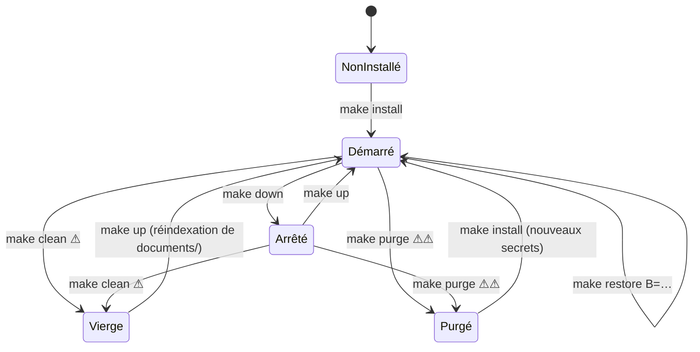
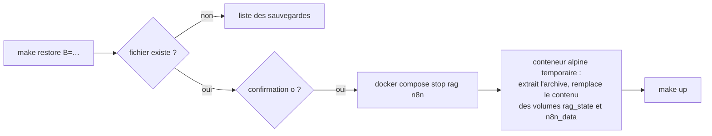
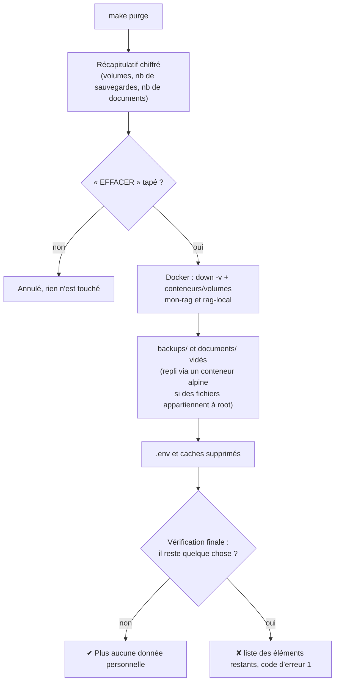

# 16 — Exploitation et maintenance

> [⬅ Précédent : 15 — Configuration](15-configuration.md) · [🏠 Sommaire](README.md) · [Suivant : 17 — Tests ➡](17-tests.md)

**Sur cette page**
1. [Toutes les commandes `make`](#1-toutes-les-commandes-make)
2. [Cycle de vie du service](#2-cycle-de-vie-du-service)
3. [Sauvegarde et restauration](#3-sauvegarde-et-restauration)
4. [Mises à jour](#4-mises-à-jour)
5. [Surveillance et journaux](#5-surveillance-et-journaux)
6. [Ressources et performances](#6-ressources-et-performances)
7. [Tâches périodiques recommandées](#7-tâches-périodiques-recommandées)
8. [Effacer toutes les données perso et publier sur GitHub](#8-effacer-toutes-les-données-perso-et-publier-sur-github)

---

## 1. Toutes les commandes `make`

`make` (sans argument) affiche l'aide. Les commandes marquées 🐳 s'exécutent **dans** le conteneur `rag` via `docker compose exec -T rag python -m rag.cli …`.

| Catégorie | Commande | Rôle |
|---|---|---|
| **Installation** | `make install` | Première installation : `.env`, Ollama, modèles, images, démarrage |
| | `make env` | Crée / complète `.env`, crée `documents/ajouts` et `backups/` (700) |
| | `make ollama-check` | Ollama installé, démarré, joignable par Docker ? |
| | `make ollama-config` | Configure Ollama pour Docker + mémoire (sudo, une fois) |
| | `make models` | Télécharge `CHAT_MODEL` et `EMBED_MODEL` |
| | `make build` | Télécharge / construit les images |
| | `make stop-ancien` | Arrête l'ancienne version (`rag-local`) |
| **Cycle de vie** | `make up` | Démarre tout, attend le service, configure n8n, affiche les adresses |
| | `make down` | Arrête tout (données conservées) |
| | `make restart` | `down` + `up` |
| | `make ps` | État des conteneurs |
| | `make update` | Met à jour les images et relance |
| **Accès** | `make open` | Ouvre le chat (`xdg-open`) |
| | `make n8n` | Ouvre n8n |
| **Utilisation** 🐳 | `make ask Q="…"` | Question (mode auto) |
| 🐳 | `make web Q="…"` | Question forcée sur internet |
| 🐳 | `make index` | Synchronise maintenant (attend la fin) |
| 🐳 | `make reindex` | Vide l'index et relit tout (attend la fin) |
| **Diagnostic** 🐳 | `make status` | Modèles, documents, indexation |
| 🐳 | `make docs` | Fichiers et erreurs de lecture |
| | `make doctor` | `ollama-check` + diagnostic complet |
| | `make logs [s=service]` | Journaux en direct (100 dernières lignes) |
| **n8n** | `make n8n-setup` | Compte + activation des workflows |
| | `make n8n-import` | ⚠️ Réimporte les workflows du projet |
| **Données** | `make backup` | Sauvegarde manuelle (+ `.env`) |
| | `make restore B=…` | Restaure une sauvegarde (confirmation) |
| | `make clean` | ⚠️ Supprime conteneurs **et volumes** (index, conversations, n8n) — `documents/` conservé |
| | `make purge` | ⚠️⚠️ Efface **toutes** les données perso (+ journaux, sauvegardes, documents, `.env`) — [§8](#8-effacer-toutes-les-données-perso-et-publier-sur-github) |
| **Qualité** | `make test` | Tests automatiques dans le conteneur |

---

## 2. Cycle de vie du service



Après un **redémarrage du PC** : les conteneurs (`restart: unless-stopped`) et Ollama (systemd) repartent seuls. Les réponses qui étaient en cours sont marquées « interrompues ».

---

## 3. Sauvegarde et restauration

### Sauvegarder
```bash
make backup
# ✔ Sauvegarde : backups/manuel-20261110-184500.tar.gz (+ .env). L'index Qdrant se reconstruit depuis documents/.
```
Les sauvegardes automatiques quotidiennes (`backups/auto-AAAAMMJJ.tar.gz`, 7 jours) sont faites par le service `backup`. ➡ [12 — Sauvegardes](12-donnees.md#6-sauvegardes).

💡 Copie régulièrement `backups/` **et** `documents/` sur un support externe.

### Restaurer
```bash
ls backups/
make restore B=backups/auto-20261109.tar.gz
# Remplacer les conversations et les données n8n actuelles par … ? [o/N] o
```



Le `.env` n'est **pas** restauré automatiquement : si besoin, `cp backups/manuel-….env .env` avant `make up`.

---

## 4. Mises à jour

| Élément | Comment | Remarque |
|---|---|---|
| Images Docker (Qdrant, SearXNG, n8n, Python de base) | `make update` | Les versions de Qdrant et n8n sont **épinglées** dans `.env` : modifie `QDRANT_VERSION` / `N8N_VERSION` pour monter de version |
| Dépendances Python | `make update` (rebuild `--pull`) | `requirements.txt` fixe des bornes, pas des versions exactes |
| Ollama | `curl -fsSL https://ollama.com/install.sh \| sh` | la config `mon-rag.conf` est conservée |
| Modèles | `ollama pull gpt-oss:20b` | |
| Code du projet | remplacer les fichiers puis `make up` | `.env` complété automatiquement si de nouvelles clés apparaissent |

⚠️ Lire les notes de version de Qdrant avant un saut de version majeur ; au pire, `make clean` puis `make up` reconstruit l'index (mais efface aussi conversations et n8n : sauvegarde d'abord).

---

## 5. Surveillance et journaux

| Source | Commande / emplacement |
|---|---|
| Journaux du service `rag` | `make logs s=rag` — format `date NIVEAU module : message` |
| Autres services | `make logs s=qdrant` / `searxng` / `n8n` / `backup` |
| Tous | `make logs` |
| État dans le chat | pied de la barre latérale (toutes les 15 s) |
| Ollama | `journalctl -u ollama -f` |
| Mémoire | `free -h` (le swap ne doit pas grossir pendant une réponse) |

Messages de journal utiles :
| Message | Sens |
|---|---|
| `Prêt : Ollama … (gpt-oss:20b + bge-m3), documents /data/documents` | service démarré |
| `Indexé : ajouts/cv.pdf (6 morceaux, texte, 3.2 s)` | fichier indexé |
| `✘ scan.jpg : aucun texte…` | échec de lecture |
| `Synchronisation : 3 ajouté(s), …` | bilan d'un passage |
| `Question '…' → docs ('…')` | aiguillage |
| `Modèle d'embeddings changé (… → …) : réindexation complète` | |
| `Aiguillage impossible (…) : documents par défaut` | JSON du routeur invalide |

---

## 6. Ressources et performances

| Ressource | Consommation typique |
|---|---|
| RAM — `gpt-oss:20b` | ~14 Go (chargé à la demande, libéré après `OLLAMA_KEEP_ALIVE`) |
| RAM — `bge-m3` | ~1,2 Go |
| RAM — conteneurs | rag ~300 Mo (+ pics OCR), Qdrant ~100–500 Mo, n8n ~250 Mo, SearXNG ~150 Mo |
| Disque | modèles ~15 Go, images ~3 Go, index ≈ 2–5× la taille du texte extrait |
| CPU | génération : tous les cœurs ; OCR : 4 threads |

Temps typiques (CPU de bureau récent, ~30 Go de RAM) :
| Opération | Durée |
|---|---|
| Premier mot d'une réponse | 10–20 s (≈ 30 s si le modèle doit être rechargé) |
| Débit | 20–25 mots/s |
| Aiguillage | quelques secondes |
| Indexation PDF texte | < 1 s/page |
| OCR d'une photo / page scannée | 10–60 s |

Leviers : `QUERY_ROUTER=0` (un appel LLM de moins), `TOP_K` plus petit, modèle plus petit, `LLM_THINK=off` (modèles non gpt-oss), `OLLAMA_KEEP_ALIVE=-1` (jamais déchargé si la RAM le permet).

---

## 7. Tâches périodiques recommandées

| Fréquence | Tâche |
|---|---|
| Hebdomadaire | Vérifier `make docs` (fichiers en erreur) |
| Mensuelle | `make update`, copier `backups/` et `documents/` hors machine |
| Après ajout massif de scans | `make status` pour suivre l'indexation |
| Après changement de matériel / OS | `make doctor` |

---

## 8. Effacer toutes les données perso et publier sur GitHub

### `make purge`
```bash
make purge                 # tout effacer (demande de taper EFFACER)
make purge GARDER_DOCS=1   # tout effacer SAUF documents/
make purge OUI=1           # sans confirmation (scripts) — à manier avec précaution
```

| Effacé | Où | Comment |
|---|---|---|
| Base de connaissance (index Qdrant) | volume `mon-rag_qdrant_data` | `docker compose down -v` |
| Conversations + état d'indexation | volume `mon-rag_rag_state` (`rag.sqlite3`) | idem |
| Workflows, compte et exécutions n8n | volume `mon-rag_n8n_data` | idem |
| Conteneurs et **leurs journaux** | Docker (`json-file`) | suppression des conteneurs du projet |
| Données de l'ancienne version | conteneurs et volumes du projet `rag-local` | `docker rm -f` / `docker volume rm` |
| Sauvegardes | `backups/` | vidé |
| Tes documents | `documents/` (sauf avec `GARDER_DOCS=1`) | vidé, `documents/ajouts/.gitkeep` recréé |
| Secrets | `.env`, `.env.*` (sauf `.env.example`) | supprimés |
| Caches | `__pycache__/`, `.pytest_cache/` | supprimés |

**Conservés :** le code, les images Docker (aucune donnée perso dedans), les modèles Ollama, la configuration systemd d'Ollama (`mon-rag.conf`).



Script : `scripts/purge.sh`. Si Docker est arrêté, les fichiers sont quand même effacés et le script signale que les volumes restent à supprimer (relancer `make purge` une fois Docker démarré).

Pour **repartir** ensuite : `make install` (nouveaux mots de passe générés).

### Ce que le `.gitignore` protège en plus
Même sans purge, ces éléments ne sont **jamais** ajoutés par `git add` :

| Motif | Protège |
|---|---|
| `.env`, `.env.*` (sauf `.env.example`) | mots de passe et secrets |
| `backups/` | sauvegardes (conversations, n8n) |
| `documents/*` (sauf `documents/ajouts/.gitkeep`) | tes documents |
| `__pycache__/`, `*.pyc`, `.pytest_cache/` | caches |

Les volumes Docker (index, conversations) sont hors du dossier du projet : ils ne peuvent pas être publiés par erreur.

### Check-list avant le premier `git push`
1. `make purge` (ou au minimum vérifier le `.gitignore`).
2. `git status --ignored` : ni `.env`, ni `documents/…`, ni `backups/` dans les fichiers suivis.
3. Relire les **exemples** du code et de la doc (`Makefile`, `.env.example`, tests) : ils ne doivent rien révéler que tu veux garder privé (ville, fuseau horaire `TIMEZONE`…).
4. ⚠️ Si un fichier perso a déjà été **commité** une fois, le supprimer ne suffit pas : il reste dans l'historique git. Il faut réécrire l'historique (`git filter-repo`) ou repartir d'un dépôt neuf.

---

> [⬅ Précédent : 15 — Configuration](15-configuration.md) · [🏠 Sommaire](README.md) · [Suivant : 17 — Tests ➡](17-tests.md)
