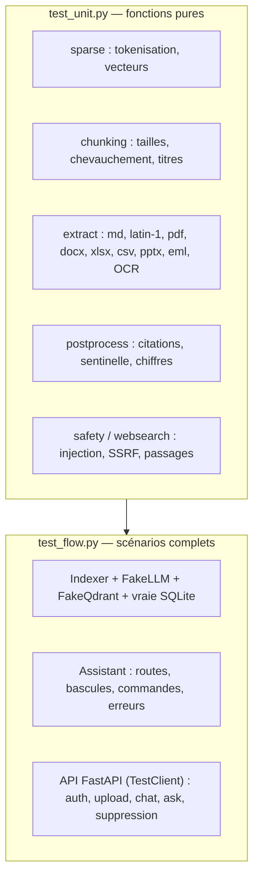

# 17 — Tests

> [⬅ Précédent : 16 — Exploitation](16-exploitation.md) · [🏠 Sommaire](README.md) · [Suivant : 18 — Dépannage ➡](18-depannage.md)

**Sur cette page**
1. [Lancer les tests](#1-lancer-les-tests)
2. [Stratégie](#2-stratégie)
3. [Les faux services](#3-les-faux-services)
4. [Tests unitaires (`test_unit.py`)](#4-tests-unitaires-test_unitpy)
5. [Tests de bout en bout (`test_flow.py`)](#5-tests-de-bout-en-bout-test_flowpy)
6. [Écrire un nouveau test](#6-écrire-un-nouveau-test)

---

## 1. Lancer les tests

```bash
make test
```
Ce qui s'exécute :
```bash
docker compose run --rm --no-deps -T -v "$PWD/app/tests:/app/tests:ro" rag \
    python -m pytest -q -p no:cacheprovider tests
```
- dans l'image `rag` (mêmes Tesseract, pandoc, bibliothèques qu'en production) ;
- `--no-deps` : **aucun** autre service n'est démarré (Ollama, Qdrant, SearXNG sont simulés) ;
- les tests sont montés en lecture seule (ils ne sont pas copiés dans l'image).

💡 Hors Docker (développement) : `cd app && pip install -r requirements.txt pytest && python -m pytest -q tests` (les tests d'OCR/pandoc sont sautés si les outils manquent).

---

## 2. Stratégie



Aucun test n'a besoin de réseau ni de modèle : la suite tourne en quelques secondes.

---

## 3. Les faux services

| Faux | Remplace | Comportement |
|---|---|---|
| `FakeLLM.embed` | Ollama `/api/embed` | « sac de mots haché » : chaque token incrémente une des 64 dimensions (MD5), vecteur normalisé → des textes partageant des mots sont proches |
| `FakeLLM.chat_stream` | Ollama `/api/chat` | renvoie les réponses **scriptées** de `llm.replies` (dans l'ordre), précédées d'un `thinking`, découpées en morceaux de 7 caractères ; enregistre chaque prompt dans `llm.calls` |
| `FakeLLM.tags/loaded` | `/api/tags`, `/api/ps` | les deux modèles sont « installés » |
| `FakeQdrant` | Qdrant | dictionnaire en mémoire ; `query_dense` = produit scalaire ; `query_sparse` = produit sur indices communs ; `delete_path(keep_sha)` fidèle |
| `websearch.search` / `read_pages` | SearXNG + web | remplacés par `monkeypatch` dans les tests concernés |

Fixture `env` : dossier `documents` temporaire, base SQLite temporaire, `min_score=0.2` (adapté aux faux embeddings), web `auto`, aiguillage activé. Elle renvoie `(docs, db, llm, store, idx, asst)`.

---

## 4. Tests unitaires (`test_unit.py`)

| Test | Vérifie |
|---|---|
| `test_tokenize_accents_stopwords_plurals` | accents retirés, mots vides ignorés, pluriels simples ramenés au singulier |
| `test_sparse_vectors_sorted_unique` | indices triés et uniques, poids corrects |
| `test_chunks_respect_size_and_overlap` | aucun morceau ne dépasse la taille ; chevauchement présent |
| `test_chunks_keep_headings_and_long_sentences` | la section suit les morceaux ; une phrase très longue est coupée proprement |
| `test_empty_pages_ignored` | pas de morceau pour une page vide |
| `test_join_chunks_removes_overlap` | `/resume` recolle sans doublons |
| `test_extract_markdown_and_latin1` | décodage `latin-1` |
| `test_extract_pdf_pages` | une page par page PDF, numérotées |
| `test_extract_docx_with_table` | titres Word → `#`, tableau → Markdown |
| `test_extract_xlsx_rows_as_records` | lignes → « colonne : valeur » |
| `test_extract_csv_semicolon` | séparateur `;` détecté |
| `test_extract_pptx` | diapositives + labels |
| `test_extract_eml` | en-têtes + corps |
| `test_ocr_image` | OCR Tesseract sur une image générée (sauté si Tesseract absent) |
| `test_fix_citations` | `[1, 2]` → `[1][2]`, numéros hors plage retirés |
| `test_not_found_sentinel` | détection de `NON_TROUVE` (avec mise en forme parasite) |
| `test_unverified_numbers` | formats `1 200` / `1.200` / `84,20`, nombres de la question ignorés |
| `test_sanitize_injection` | phrases d'injection FR/EN retirées, texte normal intact |
| `test_ssrf_guard` | `localhost`, IP privées, `.internal` refusés |
| `test_best_passages_keeps_relevant` | paragraphes pertinents gardés dans l'ordre |
| `test_parse_json_tolerant` | JSON entouré de texte récupéré |

---

## 5. Tests de bout en bout (`test_flow.py`)

| Test | Scénario | Assertions principales |
|---|---|---|
| `test_incremental_sync` | 2 fichiers → modification → suppression | `added == 2` ; après modification `updated == 1` et **l'ancienne version a disparu** de l'index ; après suppression `removed == 1` |
| `test_unreadable_file_reported` | faux PDF corrompu | `status == "error"`, erreur listée |
| `test_docs_answer_with_citations` | question sur le CV ; le faux LLM cite `[1]` et `[7]` et invente « 45 » | événements `token`, `thinking`, `done` ; `[7]` retiré + avertissement ; `45` dans `unverified` ; source 1 citée ; prompt contient `<extrait n="1"` |
| `test_not_found_falls_back_to_web` | LLM répond `NON_TROUVE` | événement `reset` ; **la sentinelle n'est jamais diffusée** ; route `web` avec `fallback` et sources URL |
| `test_doc_mode_never_uses_web` | mode `docs` + `NON_TROUVE` | reste en `docs`, message « ne contiennent pas » |
| `test_chat_route_uses_history` | routeur → `chat` | l'historique est transmis au LLM |
| `test_router_garbage_defaults_to_docs` | routeur renvoie du texte non JSON | route `docs` |
| `test_commands` | `/docs`, `/aide`, `/truc`, `/resume cv`, `/resume facture` | liste, aide, « inconnue », résumé avec le **document entier**, « Aucun document » |
| `test_llm_down_gives_clear_error` | le LLM lève `LLMError` | événement `error` mentionnant Ollama |
| `test_api_end_to_end` | API complète via `TestClient` | `401` sans/mauvais identifiants ; upload (format refusé) ; `index wait` ; **traversée `../../etc/passwd` → 404** ; chat NDJSON `meta…done` ; conversation enregistrée ; question de suite (« et où ? ») utilise l'historique ; `/api/ask` ; suppression conversation et document |

---

## 6. Écrire un nouveau test

```python
def test_mon_scenario(env):
    docs, db, llm, store, idx, asst = env
    (docs / "contrat.md").write_text("Fin du contrat : 31 août 2027.")
    run(idx.sync())

    llm.replies = [
        '{"route": "docs", "query": "fin du contrat"}',   # 1er appel : aiguillage
        "Ton contrat se termine le 31 août 2027 [1].",    # 2e appel : réponse
    ]
    done = run(collect(asst.answer("Quand se termine mon contrat ?", [])))[-1]

    assert done["type"] == "done"
    assert done["meta"]["route"] == "docs"
    assert done["meta"]["unverified"] == []
```

Points d'attention :
- l'ordre de `llm.replies` doit suivre l'ordre des appels LLM (aiguillage, puis réponse, puis éventuellement web) ;
- avec `QUERY_ROUTER` actif, **chaque** question en mode auto consomme une réponse d'aiguillage ;
- `llm.calls[-1]` permet d'inspecter le dernier prompt envoyé.

---

> [⬅ Précédent : 16 — Exploitation](16-exploitation.md) · [🏠 Sommaire](README.md) · [Suivant : 18 — Dépannage ➡](18-depannage.md)
