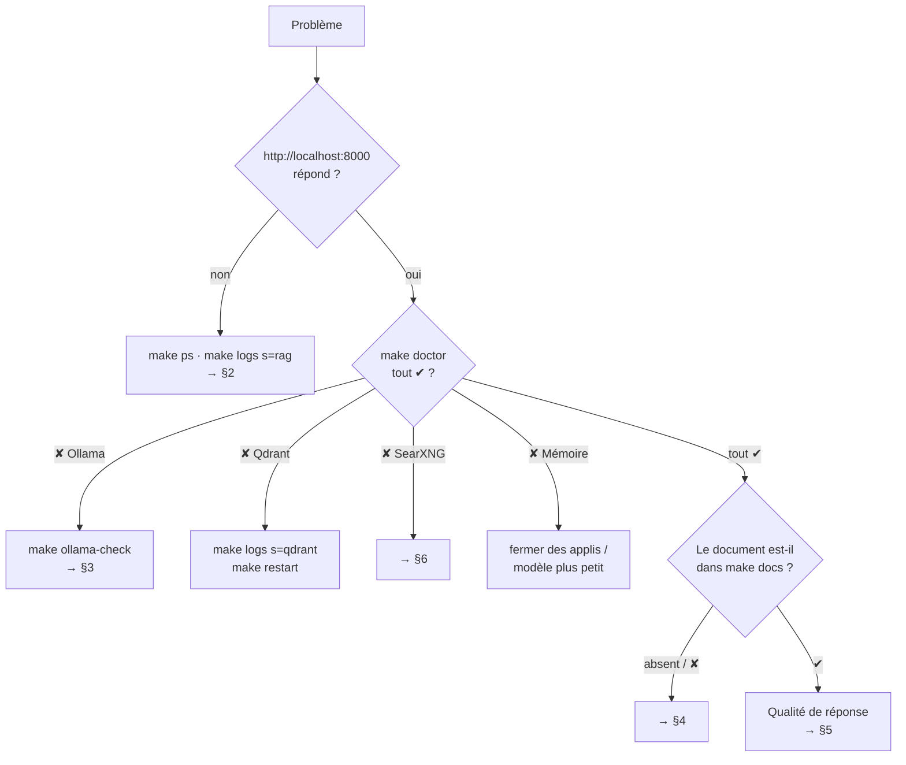

# 18 — Dépannage

> [⬅ Précédent : 17 — Tests](17-tests.md) · [🏠 Sommaire](README.md) · [Suivant : 19 — Référence du code ➡](19-reference-code.md)

**Sur cette page**
1. [Arbre de diagnostic](#1-arbre-de-diagnostic)
2. [Installation et démarrage](#2-installation-et-démarrage)
3. [Ollama et modèles](#3-ollama-et-modèles)
4. [Indexation et documents](#4-indexation-et-documents)
5. [Qualité des réponses](#5-qualité-des-réponses)
6. [Internet](#6-internet)
7. [Interface et accès](#7-interface-et-accès)
8. [n8n](#8-n8n)
9. [Remise à zéro](#9-remise-à-zéro)

---

## 1. Arbre de diagnostic

Commandes de base : `make status`, `make doctor`, `make docs`, `make logs s=rag`.

---

## 2. Installation et démarrage

| Symptôme | Cause probable | Solution |
|---|---|---|
| `make install` : « Ollama n'est pas installé » | Ollama absent | `curl -fsSL https://ollama.com/install.sh \| sh` |
| « port is already allocated » sur 5678 ou 8000 | ancienne version ou autre service | `make stop-ancien`, ou changer `RAG_PORT` / `N8N_PORT` |
| `→ Attente du service rag .....` sans fin | conteneur en échec | `make logs s=rag` (erreur Python, permissions) |
| Permissions refusées sur `documents/` | `HOST_UID`/`HOST_GID` incorrects | vérifier `id -u` / `id -g` vs `.env`, puis `make build up` |
| Conteneurs sans DNS (pas d'internet, pull Ollama impossible depuis Docker) | résolveur `127.0.0.53` hérité | `DNS_1`/`DNS_2` dans `.env` (déjà par défaut) |
| `.env` manquant après copie du projet | non versionné | `make env` en génère un nouveau (nouveaux secrets) |

---

## 3. Ollama et modèles

| Symptôme | Cause | Solution |
|---|---|---|
| « ⚠️ Le modèle de langage n'a pas pu répondre : Ollama injoignable » | Ollama arrêté ou n'écoute que sur 127.0.0.1 | `systemctl status ollama` ; `make ollama-check` ; si demandé `make ollama-config` |
| `make ollama-check` : « n'écoute que sur 127.0.0.1 » | configuration systemd absente | `make ollama-config` |
| Ollama joignable depuis l'hôte mais pas depuis Docker | pare-feu | `sudo ufw allow from 172.16.0.0/12 to any port 11434 proto tcp` |
| « modèle(s) absent(s) » | pas téléchargé | `make models` |
| Réponse très lente / jamais | RAM saturée, swap | `free -h` ; fermer des applis ; `qwen3:8b` ; `OLLAMA_NUM_CTX=8192` |
| Premier message très long (~30 s de plus) | modèle déchargé après `OLLAMA_KEEP_ALIVE` | normal ; `OLLAMA_KEEP_ALIVE=-1` pour le garder |
| « Le modèle … a refusé la requête (400) » | paramètre `think` non supporté, contexte trop grand | `LLM_THINK=off` (modèles non gpt-oss), réduire `OLLAMA_NUM_CTX` |
| qwen3 très lent, longues « réflexions » | réflexion activée | `LLM_THINK=off` |

---

## 4. Indexation et documents

| Symptôme | Cause | Solution |
|---|---|---|
| Fichier absent de `make docs` | extension non prise en charge, dossier/fichier caché, nom `~$…` | voir [06 — formats](06-extraction.md#2-tableau-des-formats) ; renommer |
| ⚠️ « PDF protégé par mot de passe » | chiffré | `qpdf --decrypt --password=… in.pdf out.pdf` |
| ⚪ « aucun texte trouvé » | photo sans texte, scan illisible | rescanner (300 dpi, bien éclairé) |
| OCR plein d'erreurs | image floue, petite, inclinée | meilleure photo ; préférer un PDF natif |
| Indexation « bloquée » | gros scans (OCR lent) | patienter (`make status` montre le fichier en cours) |
| « Ollama indisponible » dans le bilan | Ollama tombé pendant l'indexation | relancer Ollama ; la synchro reprend seule |
| Changement de `CHUNK_SIZE` sans effet | non automatique | `make reindex` |
| Fichier supprimé encore cité | synchro pas encore passée | attendre 30 s ou `make index` |
| Tableur : lignes manquantes | > 5 000 lignes par feuille | découper le fichier |

---

## 5. Qualité des réponses

| Symptôme | Cause | Solution |
|---|---|---|
| « Je n'ai trouvé aucun passage pertinent » alors que l'info existe | seuil trop haut, vocabulaire différent | baisser `MIN_SCORE` (0,35) ; reformuler avec les mots du document ; vérifier `make docs` |
| Réponses hors sujet / sources sans rapport | seuil trop bas | monter `MIN_SCORE` (0,45) |
| Bascule sur internet alors que c'est personnel | aiguillage ou rien trouvé | utiliser `/doc` ou le mode 📄 ; noms de fichiers explicites |
| Va dans les documents pour une question générale | règle « en cas de doute : docs » | `/chat` ou `/web` |
| Info incomplète sur une question large | seulement `TOP_K` extraits | `/resume <doc>` ; augmenter `TOP_K` ; poser des questions plus ciblées |
| 🔎 « À vérifier » sur un chiffre correct | chiffre calculé (somme, différence) ou format différent | normal : vérifier dans la source |
| ⚠️ « référence(s) … retirée(s) » | le modèle a inventé un numéro | normal, déjà corrigé |
| « Et là-bas ? » mal compris | historique trop court ou aiguillage désactivé | `MEMORY_TURNS` ↑ ; `QUERY_ROUTER=1` |
| Mauvaise date « aujourd'hui » | fuseau | `TIMEZONE` |

---

## 6. Internet

| Symptôme | Cause | Solution |
|---|---|---|
| « Recherche internet indisponible : SearXNG injoignable » | conteneur arrêté | `make ps` ; `make up` |
| « je n'ai rien trouvé sur internet » systématique | moteurs bloqués (captcha) ou DNS | `make logs s=searxng` ; attendre ; vérifier `DNS_1` |
| Pages « illisibles » | site en JavaScript, anti-robot | normal : le résumé du moteur est utilisé |
| Jamais d'internet | `WEB_SEARCH=off` | `WEB_SEARCH=auto` puis `make up` |

---

## 7. Interface et accès

| Symptôme | Cause | Solution |
|---|---|---|
| Fenêtre de connexion en boucle | mauvais identifiants | `grep CHAT_ .env` ; fermer le navigateur pour vider le cache Basic |
| Inaccessible depuis le téléphone | écoute locale seulement | `BIND_ADDR=0.0.0.0`, `make up`, pare-feu du PC (port 8000) |
| Réponse « perdue » après fermeture de l'onglet | — | rouvrir la conversation : elle reprend ou affiche le résultat |
| « Une autre réponse est en cours, je patiente… » | une génération à la fois | attendre, ou ⏹ arrêter l'autre |
| Le PDF ne s'ouvre pas à la bonne page | visionneur sans support `#page=` | utiliser le visionneur intégré du navigateur |
| Barre latérale « Service injoignable » | conteneur `rag` arrêté | `make up` |

---

## 8. n8n

| Symptôme | Cause | Solution |
|---|---|---|
| « Connexion à n8n impossible avec les identifiants du .env » | compte créé à la main | se connecter avec ses identifiants et activer les workflows « RAG – … » |
| Webhook `404` | workflow inactif | `make n8n-setup` ou activer dans n8n |
| Webhook `401` | identifiants | Basic avec `CHAT_USER`/`CHAT_PASSWORD` |
| Webhook coupe avant la réponse | délai de l'appelant | augmenter le délai (≥ 2 min) |
| Workflows modifiés écrasés | `make n8n-import` lancé | restaurer une sauvegarde ; dupliquer les workflows avant de les modifier |

---

## 9. Remise à zéro

Du plus doux au plus radical :

| Niveau | Commande | Perd |
|---|---|---|
| 1 | `make restart` | rien |
| 2 | `make reindex` | rien (l'index est reconstruit) |
| 3 | `docker volume rm mon-rag_qdrant_data` (après `make down`) puis `make up` | rien (réindexation) |
| 4 | `make clean` puis `make up` | ⚠️ conversations, n8n (sauvegarde d'abord) |
| 5 | `make purge GARDER_DOCS=1` puis `make install` | ⚠️ tout sauf `documents/` (y compris sauvegardes et journaux), nouveaux mots de passe |
| 6 | `make purge` puis `make install` | ⚠️⚠️ **tout**, documents compris : projet comme neuf |

---

> [⬅ Précédent : 17 — Tests](17-tests.md) · [🏠 Sommaire](README.md) · [Suivant : 19 — Référence du code ➡](19-reference-code.md)
