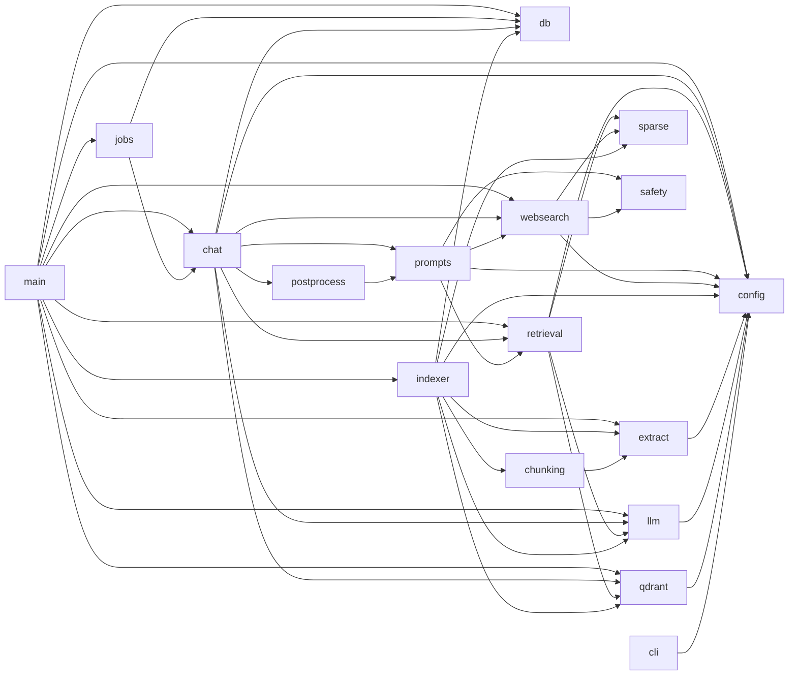

# 19 — Référence du code

> [⬅ Précédent : 18 — Dépannage](18-depannage.md) · [🏠 Sommaire](README.md) · [Suivant : 20 — Glossaire ➡](20-glossaire.md)

**Sur cette page**
1. [Carte des modules](#1-carte-des-modules)
2. [Graphe des dépendances](#2-graphe-des-dépendances)
3. [Fiches par module](#3-fiches-par-module) — [config](#configpy) · [main](#mainpy) · [jobs](#jobspy) · [chat](#chatpy) · [retrieval](#retrievalpy) · [sparse](#sparsepy) · [websearch](#websearchpy) · [prompts](#promptspy) · [postprocess](#postprocesspy) · [safety](#safetypy) · [indexer](#indexerpy) · [extract](#extractpy) · [chunking](#chunkingpy) · [llm](#llmpy) · [qdrant](#qdrantpy) · [db](#dbpy) · [cli](#clipy) · [n8n_setup](#n8n_setuppy)
4. [Scripts shell](#4-scripts-shell)
5. [Conventions de code](#5-conventions-de-code)
6. [Points d'attention relevés dans le code](#6-points-dattention-relevés-dans-le-code)
7. [Ajouter une fonctionnalité : recettes](#7-ajouter-une-fonctionnalité--recettes)

---

## 1. Carte des modules

| Module | Lignes | Responsabilité | Doc détaillée |
|---|---|---|---|
| `config.py` | 88 | Paramètres depuis l'environnement | [15](15-configuration.md) |
| `main.py` | 402 | API FastAPI, auth, routes, diagnostic | [10](10-api.md) |
| `jobs.py` | 124 | Réponses en tâche de fond, reprise | [08 §11](08-generation-reponse.md#11-tâches-de-fond-jobspy) |
| `chat.py` | 443 | Orchestration d'une réponse | [08](08-generation-reponse.md) |
| `retrieval.py` | 98 | Recherche hybride + RRF | [07](07-recherche-hybride.md) |
| `sparse.py` | 63 | Tokenisation, vecteurs creux | [05 §6](05-indexation.md#6-les-deux-vecteurs-de-chaque-morceau) |
| `websearch.py` | 164 | SearXNG, lecture des pages, SSRF | [09](09-recherche-web.md) |
| `prompts.py` | 119 | Prompts système, mise en forme des extraits | [08 §10](08-generation-reponse.md#10-les-prompts-système) |
| `postprocess.py` | 82 | Citations, sentinelle, chiffres | [08 §7](08-generation-reponse.md#7-vérifications-après-génération) |
| `safety.py` | 41 | Anti-injection | [13 §4](13-securite.md#4-injection-de-prompt) |
| `indexer.py` | 267 | Indexation incrémentale | [05](05-indexation.md) |
| `extract.py` | 378 | Lecture de tous les formats | [06](06-extraction.md) |
| `chunking.py` | 102 | Découpage en morceaux | [05 §5](05-indexation.md#5-le-découpage-en-morceaux-chunking) |
| `llm.py` | 165 | Client Ollama | [08 §13](08-generation-reponse.md#13-le-client-ollama) |
| `qdrant.py` | 137 | Client Qdrant REST | [12 §3](12-donnees.md#3-collection-qdrant-documents) |
| `db.py` | 128 | SQLite | [12 §2](12-donnees.md#2-base-sqlite-ragsqlite3) |
| `cli.py` | 132 | Commandes terminal (`make status`…) | [16](16-exploitation.md) |
| `n8n_setup.py` | 63 | Compte et activation n8n | [14](14-n8n.md) |
| `static/app.js` | 556 | Interface | [11](11-interface-web.md) |

---

## 2. Graphe des dépendances

Aucune dépendance circulaire. `config.settings` est un singleton instancié à l'import.

---

## 3. Fiches par module

### `config.py`
- `Settings` (dataclass) : un champ par variable d'environnement, avec lecteurs tolérants `_int`, `_float`, `_str`, `_bool`.
- Propriétés : `web_enabled`, `db_path` (`data_dir / "rag.sqlite3"`).
- `settings = Settings()` — instance globale ; les tests la modifient via `monkeypatch.setattr`.

### `main.py`
- `State` / `S` : conteneur global des services (db, llm, store, indexer, assistant, jobs, watch_task).
- `lifespan` : création/fermeture des services, lancement de `Indexer.watch()`.
- `auth()` → dépendance `Auth` (Bearer ou Basic).
- Middleware `security_headers` (nosniff, referrer, CSP).
- Utilitaires : `_safe_path` (anti-traversée), `_clean_name` (noms de fichiers), `_ndjson` / `_stream` (réponses NDJSON).
- Modèles Pydantic : `IndexRequest`, `Rename`, `ChatRequest`, `AskRequest`.
- Routes : voir [10 — API](10-api.md#3-récapitulatif-des-routes).

### `jobs.py`
- `Job` : `message_id`, `events` (ajout seul), `finished`, `changed` (Event), `created`, `task` ; `push(ev)`.
- `Jobs` : `start(cid, question, mode) → mid`, `run_once(question, mode, history) → final`, `_run(job, …)`, `cancel(mid)`, `follow(mid)` (rejoue + suit, `ping` toutes les 15 s), `_gc()` (> 1 h).
- `slot = asyncio.Semaphore(1)` partagé par le chat et `/api/ask`.

### `chat.py`
- `Assistant(db, llm, store, retriever)`
  - `answer(question, history, mode)` → `AsyncIterator[Event]` (point d'entrée)
  - `_route(q, history)` → `(route, query)`
  - `_docs(query, meta, t0, allow_web)` · `_web(query, meta, t0, fallback_docs)` · `_chat(q, history, meta, t0)` · `_summary(name, meta, t0)` · `_list_docs()`
  - `_generate(msgs, sentinel=True)` : streaming + gestion de `NON_TROUVE` et `<think>`
  - `_done(content, meta, t0)` : événement final avec durée
- Fonctions : `_fold` (normalisation sans accents), `_doc_source`, `_join_chunks` (recollage sans chevauchement), `_parse_json` (tolérant).
- Constantes : `HELP`, `LLM_DOWN`.

### `retrieval.py`
- `Passage` (dataclass) : `path, name, page, label, heading, text, chunk, score, keyword_rank, fused` ; propriété `where` (« nom, p. 3 »).
- `Retriever.search(query, top_k=None, min_score=None) → list[Passage]`.
- `_passage(pt, score, kw_rank)`, `_cos(a, b)` ; `RRF_K = 60`.

### `sparse.py`
- `STOPWORDS` (FR + EN), `TOKEN_RE`.
- `normalize(text)`, `tokenize(text)`, `doc_vector(text)`, `query_vector(text)` ; internes `_index` (CRC32), `_merge`.

### `websearch.py`
- `WebPage` (dataclass) : `url, title, snippet, text, suspicious` ; `WebError`.
- `search(query, n) → list[WebPage]` ; `read_pages(pages, query, n) → list[WebPage]`.
- `_is_public_host`, `_safe_url`, `_fetch` (redirections manuelles), `_html_to_text`, `best_passages`.
- Constantes : `UA`, `MAX_BYTES`, `PAGE_CHARS`, `SKIP_DOMAINS`.

### `prompts.py`
- `NOT_FOUND = "NON_TROUVE"`, `today()` (date en français, fuseau `TIMEZONE`).
- `COMMON`, `DOCS_SYSTEM`, `WEB_SYSTEM`, `CHAT_SYSTEM`, `ROUTER_SYSTEM`, `ROUTER_SCHEMA`, `SUMMARY_SYSTEM`, `PARTIAL_SUMMARY_SYSTEM`.
- `docs_messages(question, passages) → (messages, suspicious_names)` ; `web_messages(question, pages) → messages`.

### `postprocess.py`
- `fix_citations(answer, n_sources) → (texte, cités, retirés)`.
- `is_not_found(answer)`, `strip_sentinel(answer)`.
- `numbers_in(text)`, `unverified_numbers(answer, sources_text, question)` ; interne `_norm_forms`.
- Regex `CITE_RE`, `NUM_RE`.

### `safety.py`
- `PATTERNS` → `INJECTION_RE` ; `sanitize(text) → (texte, suspect)` ; `neutralize_tags(text)`.

### `indexer.py`
- `Progress` (dataclass) ; `sha256(path)`, `rel(path)`, `scan(root)`, `embed_text(name, heading, label, text)`.
- `Indexer(db, llm, store)` : `embedding_dim()`, `ensure_collection()`, `trigger()`, `watch()`, `sync(full)`, `_sync(full)`, `_index_file(key, path, row)`, `_fail(...)`, `status()` ; attributs `lock`, `progress`.
- Constantes : `IGNORED_DIRS`, `NS` (espace de noms UUID5).

### `extract.py`
- `Page`, `Extracted` (+ `text_length`), `ExtractError`.
- `SUPPORTED`, `is_supported(path)`, `extract(path)`.
- Extracteurs : `_pdf` (+ `_pdf_page_text`), `_ocr_image_file` (+ `_prepare_image`, `_tesseract_png`), `_docx` (+ `_md_table`), `_pptx`, `_xlsx` / `_csv` (+ `_rows_to_text`), `_pandoc`, `_eml`, `read_text`.
- Utilitaires : `_run` (sous-processus avec délai), `clean`.

### `chunking.py`
- `Chunk` (dataclass) : `text, page, label, heading`.
- `split_pages(pages, size, overlap)`, `split_page(page, size, overlap, heading)`, `_pieces(text, size)`.

### `llm.py`
- `Ollama` : `tags`, `loaded`, `has_model`, `capabilities`, `_think_param`, `embed`, `chat_stream`, `chat`, `close` ; `LLMError` ; `strip_think`.

### `qdrant.py`
- `Qdrant` : `info`, `vector_size`, `create`, `drop`, `ensure`, `count`, `upsert`, `delete_path`, `scroll_path`, `query_dense`, `query_sparse`, `close` ; `QdrantError` (404 → `None`, ≥ 400 → exception).

### `db.py`
- `SCHEMA` ; `DB(path)` : `get_meta/set_meta`, `files/file/save_file/delete_file/clear_files`, `create_conversation/conversation/conversations/rename_conversation/delete_conversation`, `add_message/update_message/messages`.

### `cli.py`
- Appelle l'API locale `http://127.0.0.1:8000` avec le Bearer : `status`, `docs`, `doctor`, `index(full)`, `ask(question, mode)` ; `wait_ready()` ; sous-commande de débogage `json <route>` (`docker compose exec rag python -m rag.cli json /api/status`).

### `n8n_setup.py`
- `main()` : attente `/healthz`, création du propriétaire, connexion, activation de `ragAskWebhook01` et `ragNightlySync1`. Ne lève jamais d'erreur bloquante.

---

## 4. Scripts shell

| Script | Exécuté par | Rôle |
|---|---|---|
| `scripts/env.sh` | `make env` (hôte) | crée / complète `.env` avec secrets aléatoires |
| `scripts/ollama-host.sh check\|config\|models` | `make` (hôte) | vérification, configuration systemd + ufw, téléchargement des modèles |
| `scripts/n8n-import.sh` | conteneur `n8n-import` | identifiants + import des workflows (versionné) |
| `scripts/backup-loop.sh` | conteneur `backup` | archive quotidienne + rotation |
| `scripts/purge.sh` | `make purge` (hôte) | efface toutes les données perso (volumes, conteneurs, journaux, sauvegardes, documents, `.env`) avec vérification finale |

---

## 5. Conventions de code

- Python 3.12, `from __future__ import annotations`, typage partout.
- **Asynchrone** de bout en bout (`httpx.AsyncClient`) ; travaux bloquants (OCR, SHA-256, scan) via `asyncio.to_thread`.
- Messages, logs, prompts et commentaires **en français**.
- Pas de framework LLM : clients HTTP minimalistes, faciles à remplacer par des faux en test.
- Exceptions métier dédiées (`LLMError`, `QdrantError`, `WebError`, `ExtractError`) traduites en messages lisibles.
- `# noqa: BLE001` signale les `except Exception` volontaires (robustesse : un fichier ou une page ne doit jamais tout bloquer).

---

## 6. Points d'attention relevés dans le code

Observations faites en rédigeant cette documentation (non bloquantes) :

| Où | Constat |
|---|---|
| `README.md` (racine), « Structure du projet » | mentionne un dossier `_ancien/` qui n'existe plus dans le projet |
| `cli.py`, commentaire de `json` | évoque `make cli c="json /api/status"`, mais le `Makefile` n'a pas de cible `cli` |
| `extract.py`, `_xlsx` | la lecture s'arrête à `MAX_SHEET_ROWS + 2` lignes : le message « (… N lignes supplémentaires non indexées) » affiche alors toujours un petit N, pas le vrai nombre de lignes restantes |
| `main.py`, `POST /api/index {"full": true}` sans `wait` | lance `sync(full=True)` en tâche de fond ; si une synchro est déjà en cours, la demande est silencieusement ignorée (le verrou renvoie la progression courante) |
| `jobs.py`, `_gc` | n'est appelé qu'au démarrage d'un nouveau job : les jobs terminés restent en mémoire tant qu'aucune nouvelle question n'est posée (impact négligeable) |

---

## 7. Ajouter une fonctionnalité : recettes

**Un nouveau format de fichier**
1. `extract.py` : ajouter l'extension à `SUPPORTED` (ou à un des ensembles), écrire `_monformat(path) → Extracted`, l'aiguiller dans `extract()`.
2. Si un outil système est nécessaire : l'ajouter dans `app/Dockerfile`.
3. Test dans `test_unit.py` ; `make build test`.

**Une nouvelle commande de chat** (`/xxx`)
1. `chat.py`, `Assistant.answer()` : ajouter la branche avant le traitement des modes.
2. Mettre à jour `HELP`.
3. Test dans `test_flow.py::test_commands`.

**Une nouvelle route d'API**
1. `main.py` : `@app.get/post(..., dependencies=[Auth])`.
2. Si l'interface l'utilise : `static/app.js` via `api()`.
3. Test dans `test_api_end_to_end`.

**Un nouveau paramètre**
1. `config.py` (champ + défaut), 2. `docker-compose.yml` (`environment:` du service), 3. `.env.example` (commentaire) — `make env` l'ajoutera aux `.env` existants, 4. documenter dans [15 — Configuration](15-configuration.md).

---

> [⬅ Précédent : 18 — Dépannage](18-depannage.md) · [🏠 Sommaire](README.md) · [Suivant : 20 — Glossaire ➡](20-glossaire.md)
