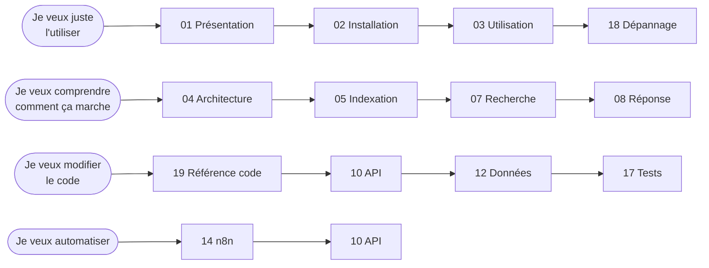

# 📚 Documentation — Assistant RAG perso, 100 % local

> **Version documentée :** état du projet au 10/11/2026 · **Projet Docker :** `mon-rag`
> **Point d'entrée rapide :** le [README racine](../README.md) (aide-mémoire). Cette documentation-ci est la version **complète** : fonctionnement interne, schémas, références.

```
            ┌──────────────────────────────────────────────────────────┐
  Toi  ───► │  « Quand se termine mon contrat ? »                      │
            │                                                          │
            │   🧭 aiguillage ─► 📄 tes documents (recherche hybride)  │
            │                 ├► 🌐 internet (SearXNG)                 │
            │                 └► 💬 conversation directe               │
            │                                                          │
  Toi  ◄─── │  « Le 31 août 2027 [1] »   + source cliquable, page 3    │
            └──────────────────────────────────────────────────────────┘
                     Tout tourne sur ton PC. Aucun document ne sort.
```

---

## 🗺️ Table des matières

### Partie I — Comprendre et utiliser
| # | Chapitre | Contenu | Public |
|---|---|---|---|
| 01 | [Présentation](01-presentation.md) | Ce que fait l'assistant, principes, vue d'ensemble | Tous |
| 02 | [Installation](02-installation.md) | Prérequis, `make install`, ce qui se passe en coulisse | Tous |
| 03 | [Utilisation au quotidien](03-utilisation.md) | Chat, modes, commandes `/…`, documents, terminal | Tous |

### Partie II — Comment ça marche (architecture)
| # | Chapitre | Contenu | Public |
|---|---|---|---|
| 04 | [Architecture générale](04-architecture.md) | Services Docker, réseau, volumes, cycle de vie | Technique |
| 05 | [Pipeline d'indexation](05-indexation.md) | Surveillance, synchronisation incrémentale, découpage, vecteurs | Technique |
| 06 | [Extraction des formats](06-extraction.md) | PDF, OCR, Word, tableurs, présentations, e-mails… | Technique |
| 07 | [Recherche hybride](07-recherche-hybride.md) | Dense + mots-clés, fusion RRF, filtre de pertinence | Technique |
| 08 | [Génération d'une réponse](08-generation-reponse.md) | Aiguillage, prompts, streaming, sentinelle, vérifications | Technique |
| 09 | [Recherche internet](09-recherche-web.md) | SearXNG, lecture des pages, protection SSRF | Technique |

### Partie III — Références
| # | Chapitre | Contenu | Public |
|---|---|---|---|
| 10 | [API HTTP](10-api.md) | Tous les points d'accès, authentification, format NDJSON | Développeur |
| 11 | [Interface web](11-interface-web.md) | Front-end (HTML/CSS/JS), reprise de flux, rendu des sources | Développeur |
| 12 | [Données et stockage](12-donnees.md) | Schéma SQLite, points Qdrant, volumes, sauvegardes | Développeur |
| 13 | [Sécurité et vie privée](13-securite.md) | Modèle de menace, anti-injection, SSRF, secrets | Tous |
| 14 | [Automatisations n8n](14-n8n.md) | Workflows fournis, import, activation, créer les tiens | Avancé |
| 15 | [Configuration (`.env`)](15-configuration.md) | Toutes les variables, valeurs par défaut, effets | Tous |

### Partie IV — Exploitation
| # | Chapitre | Contenu | Public |
|---|---|---|---|
| 16 | [Exploitation et maintenance](16-exploitation.md) | Commandes `make`, sauvegarde/restauration, mises à jour | Tous |
| 17 | [Tests](17-tests.md) | Tests unitaires et de bout en bout, faux services | Développeur |
| 18 | [Dépannage](18-depannage.md) | Symptômes → causes → solutions, arbre de diagnostic | Tous |
| 19 | [Référence du code](19-reference-code.md) | Chaque module Python, ses classes et dépendances | Développeur |
| 20 | [Glossaire](20-glossaire.md) | Tous les termes techniques expliqués simplement | Tous |

---

## 🧭 Parcours de lecture conseillés



| Je veux… | Aller à |
|---|---|
| Installer le projet pour la première fois | [02 — Installation](02-installation.md) |
| Savoir quelles commandes taper dans le chat | [03 — Commandes du chat](03-utilisation.md#3-les-commandes-du-chat) |
| Comprendre pourquoi une réponse est hors sujet | [07 — Filtre de pertinence](07-recherche-hybride.md#5-filtre-de-pertinence) puis [18 — Dépannage](18-depannage.md) |
| Changer de modèle de langage | [15 — Modèles](15-configuration.md#2-modèles-ollama) |
| Poser une question depuis un script / Telegram | [14 — Webhook](14-n8n.md#3-workflow-question-par-webhook) ou [10 — `/api/ask`](10-api.md#post-apiask) |
| Restaurer une sauvegarde | [16 — Sauvegardes](16-exploitation.md#3-sauvegarde-et-restauration) |
| Tout effacer / publier le projet sur GitHub | [16 — `make purge`](16-exploitation.md#8-effacer-toutes-les-données-perso-et-publier-sur-github) |
| Comprendre un mot (RRF, embedding, chunk…) | [20 — Glossaire](20-glossaire.md) |

---

## 🔑 Conventions de cette documentation

| Symbole | Signification |
|---|---|
| `make xxx` | Commande à lancer dans un terminal, à la racine du projet |
| `fichier.py:42` | Fichier source et numéro de ligne approximatif |
| 💡 | Astuce |
| ⚠️ | Attention / action destructive |
| 🔒 | Point de sécurité |
| *Terme en italique* | Défini dans le [glossaire](20-glossaire.md) |

Les schémas utilisent **Mermaid** (rendu automatique sur GitHub, GitLab, VS Code avec l'extension *Markdown Preview Mermaid*, Obsidian…) et de l'**ASCII** quand un schéma doit rester lisible partout.

---

<div align="center">

[Commencer la lecture : 01 — Présentation ➡](01-presentation.md)

</div>
